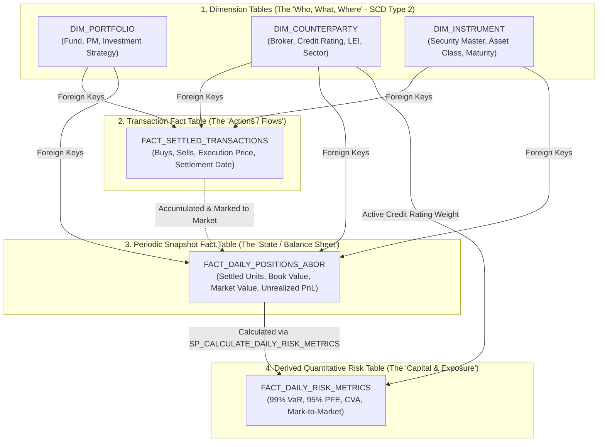

# 📚 Institutional ABOR & Quantitative Risk: Table Architecture & Financial Accounting Glossary

---

## 📌 Executive Overview

In institutional asset management, hedge funds, and prime brokerage (e.g., TIAA, Jefferies, BlackRock, Goldman Sachs), data platforms bridge the gap between **accounting ledgers** (what the firm legally owns) and **quantitative risk engines** (what the firm could lose).

This reference manual documents:
1. **The Star Schema Architecture**: All Dimension and Fact tables implemented in the platform.
2. **Table Grains & Schemas**: The exact definitions, column meanings, and design patterns (SCD Type 2, Periodic Snapshot, Transaction Grain).
3. **The Master Financial Accounting Glossary**: Definitions of institutional keywords (*Counterparty, Custodian, Holding, General Ledger, ABOR vs. IBOR, Tax Lots, Settlement*).

---

## 🏗 System Architecture Diagram

---

## 🏛 Section 1: Dimension Tables (Entity Masters)

Dimension tables provide context. In our architecture, all dimensions implement **Slowly Changing Dimension Type 2 (SCD Type 2)** to preserve complete historical point-in-time auditability.

---

### 1. `ENG.DIM_PORTFOLIO` (Fund Master)
* **Business Purpose**: Catalogs internal investment funds, strategy mandates, base accounting currencies, and active Portfolio Managers.
* **SCD Type 2 Trigger**: Portfolio Manager reassignments or investment strategy mandate changes.

| Column Name | SQL Type | Description |
| :--- | :--- | :--- |
| `PORTFOLIO_KEY` | `NUMBER AUTOINCREMENT` | **Primary Key** (Surrogate). |
| `PORTFOLIO_ID` | `VARCHAR(50)` | Natural Business Key (e.g., `PORT_001`). |
| `PORTFOLIO_NAME` | `VARCHAR(255)` | Official fund title (e.g., `Apex Global Macro Fund`). |
| `BASE_CURRENCY` | `VARCHAR(10)` | Reporting currency (`USD`, `EUR`, `GBP`). |
| `PORTFOLIO_MANAGER`| `VARCHAR(100)` | Lead portfolio manager / trader. |
| `INVESTMENT_STRATEGY`| `VARCHAR(100)` | Strategy category (e.g., `Long/Short Equity`, `Global Macro`). |
| `INCEPTION_DATE` | `DATE` | Fund launch date. |
| `EFFECTIVE_START_DATE`| `DATE` | SCD2 validity start date. |
| `EFFECTIVE_END_DATE` | `DATE` | SCD2 validity end date (`9999-12-31` for active). |
| `IS_ACTIVE` | `BOOLEAN` | `TRUE` if this is the currently active record. |
| `UPDATED_AT` | `TIMESTAMP_NTZ` | Timestamp when record was loaded. |

---

### 2. `ENG.DIM_COUNTERPARTY` (Legal Entity Master)
* **Business Purpose**: Tracks trading counterparties, brokers, clearing houses, credit rating migrations, and netting contracts.
* **SCD Type 2 Trigger**: Credit rating upgrades/downgrades (`AAA` $\to$ `BBB`) or changes in legal entity status.

| Column Name | SQL Type | Description |
| :--- | :--- | :--- |
| `COUNTERPARTY_KEY` | `NUMBER AUTOINCREMENT` | **Primary Key** (Surrogate). |
| `COUNTERPARTY_ID` | `VARCHAR(50)` | Natural Business Key (e.g., `CPTY_001`). |
| `COUNTERPARTY_NAME`| `VARCHAR(255)` | Legal entity name (e.g., `Goldman Sachs Prime Brokerage`). |
| `LEI_CODE` | `VARCHAR(50)` | 20-character global Legal Entity Identifier. |
| `SECTOR` | `VARCHAR(100)` | Institutional sector (`Commercial Bank`, `Hedge Fund`, `Sovereign`). |
| `CREDIT_RATING` | `VARCHAR(10)` | External credit rating (`AAA`, `AA`, `A`, `BBB`, `BB`, `B`, `CCC`). |
| `JURISDICTION` | `VARCHAR(50)` | Legal tax home country (`US`, `UK`, `EU`, `KY`, `JP`). |
| `NETTING_AGREEMENT_TYPE`| `VARCHAR(50)` | Legal collateral contract (`ISDA_CSA`, `GMRA`, `EMA`, `NONE`). |
| `EFFECTIVE_START_DATE`| `DATE` | SCD2 validity start date. |
| `EFFECTIVE_END_DATE` | `DATE` | SCD2 validity end date (`9999-12-31` for active). |
| `IS_ACTIVE` | `BOOLEAN` | `TRUE` if currently active. Used by Risk Engine queries. |
| `UPDATED_AT` | `TIMESTAMP_NTZ` | Audit timestamp. |

---

### 3. `ENG.DIM_INSTRUMENT` (Security Master)
* **Business Purpose**: Master taxonomy of financial assets, derivatives, and contracts traded by the firm.
* **SCD Type 2 Trigger**: Asset class reclassifications, ticker changes, or contractual modifications.

| Column Name | SQL Type | Description |
| :--- | :--- | :--- |
| `INSTRUMENT_KEY` | `NUMBER AUTOINCREMENT` | **Primary Key** (Surrogate). |
| `INSTRUMENT_ID` | `VARCHAR(50)` | Security identifier (e.g., `INST_101`). |
| `INSTRUMENT_NAME` | `VARCHAR(255)` | Full security title (e.g., `US Treasury Note 4.25% 2030`). |
| `ASSET_CLASS` | `VARCHAR(100)` | Primary asset class (`Fixed Income`, `Equities`, `Derivatives`, `FX`). |
| `SUB_ASSET_CLASS` | `VARCHAR(100)` | Granular category (`Sovereign Debt`, `Interest Rate Swap`, `Tech Equity`). |
| `CURRENCY` | `VARCHAR(10)` | ISO currency code (`USD`, `EUR`, `GBP`). |
| `MATURITY_DATE` | `DATE` | Contract expiration / bond maturity (`NULL` for equities). |
| `EFFECTIVE_START_DATE`| `DATE` | SCD2 validity start date. |
| `EFFECTIVE_END_DATE` | `DATE` | SCD2 validity end date (`9999-12-31` for active). |
| `IS_ACTIVE` | `BOOLEAN` | `TRUE` if currently active. |
| `UPDATED_AT` | `TIMESTAMP_NTZ` | Audit timestamp. |

---

## 📊 Section 2: Fact Tables (Events, Snapshots & Risk Ledgers)

---

### 1. `ENG.FACT_SETTLED_TRANSACTIONS` (Transaction Fact Table)
* **Pattern**: **Transaction Grain** (One row per trade execution event).
* **Business Purpose**: Immutable historical audit trail of all buys, sells, quantities, execution prices, and settlement dates.

| Column Name | SQL Type | Description |
| :--- | :--- | :--- |
| `TRANSACTION_KEY` | `NUMBER AUTOINCREMENT` | Surrogate Primary Key. |
| `TRANSACTION_ID` | `VARCHAR(50)` | Natural Trade ID (e.g., `TXN_009841`). |
| `TRANSACTION_DATE` | `DATE` | **Trade Date ($T$)**: When trade was agreed on. |
| `SETTLEMENT_DATE` | `DATE` | **Settlement Date ($T+1$)**: When cash & title legally exchanged. |
| `PORTFOLIO_ID` | `VARCHAR(50)` | FK to `DIM_PORTFOLIO`. |
| `COUNTERPARTY_ID` | `VARCHAR(50)` | FK to `DIM_COUNTERPARTY`. |
| `INSTRUMENT_ID` | `VARCHAR(50)` | FK to `DIM_INSTRUMENT`. |
| `TRANSACTION_TYPE` | `VARCHAR(50)` | Action (`BUY`, `SELL`). |
| `QUANTITY` | `NUMBER(38,4)` | Number of shares or bond face value traded. |
| `PRICE` | `NUMBER(38,4)` | Agreed price per unit at trade execution. |
| `SETTLED_AMOUNT` | `NUMBER(38,2)` | Total money exchanged: $\text{QUANTITY} \times \text{PRICE}$. |
| `CURRENCY` | `VARCHAR(10)` | Transaction currency (`USD`). |
| `INGESTED_AT` | `TIMESTAMP_NTZ` | Load timestamp. |

---

### 2. `ENG.FACT_DAILY_POSITIONS_ABOR` (Periodic Snapshot Fact Table)
* **Pattern**: **Periodic Snapshot Grain** (One row per *Date + Portfolio + Counterparty + Instrument*).
* **Business Purpose**: The authoritative **Accounting Book of Record (ABOR)** holding ledger at 4:00 PM market close. Used for official Net Asset Value (NAV) reporting and general ledger reconciliations.

| Column Name | SQL Type | Description |
| :--- | :--- | :--- |
| `POSITION_KEY` | `NUMBER AUTOINCREMENT` | Surrogate Primary Key. |
| `POSITION_DATE` | `DATE` | Business snapshot date (e.g., `2026-03-31`). |
| `PORTFOLIO_ID` | `VARCHAR(50)` | FK to `DIM_PORTFOLIO`. |
| `COUNTERPARTY_ID` | `VARCHAR(50)` | FK to `DIM_COUNTERPARTY`. |
| `INSTRUMENT_ID` | `VARCHAR(50)` | FK to `DIM_INSTRUMENT`. |
| `SETTLED_QUANTITY` | `NUMBER(38,4)` | Total units legally held and cleared in custody. |
| `BOOK_VALUE` | `NUMBER(38,2)` | Original historical purchase cost (Cost Basis). |
| `MARKET_VALUE` | `NUMBER(38,2)` | Current Mark-to-Market (MTM) worth: $\text{Quantity} \times \text{Close Price}$. |
| `UNREALIZED_PNL` | `NUMBER(38,2)` | Paper gain/loss: $\text{MARKET\_VALUE} - \text{BOOK\_VALUE}$. |
| `INGESTED_AT` | `TIMESTAMP_NTZ` | Load timestamp. |

---

### 3. `ENG.FACT_DAILY_RISK_METRICS` (Derived Quantitative Risk Table)
* **Pattern**: **Derived Analytics Grain** (Calculated directly from `FACT_DAILY_POSITIONS_ABOR` + `DIM_COUNTERPARTY`).
* **Business Purpose**: Stores the regulatory and quantitative risk metrics computed by Snowflake Stored Procedure `SP_CALCULATE_DAILY_RISK_METRICS`.

| Column Name | SQL Type | Description |
| :--- | :--- | :--- |
| `RISK_METRIC_KEY` | `NUMBER AUTOINCREMENT` | Surrogate Primary Key. |
| `METRIC_DATE` | `DATE` | Risk evaluation date (matches `POSITION_DATE`). |
| `PORTFOLIO_ID` | `VARCHAR(50)` | FK to `DIM_PORTFOLIO`. |
| `COUNTERPARTY_ID` | `VARCHAR(50)` | FK to `DIM_COUNTERPARTY`. |
| `INSTRUMENT_ID` | `VARCHAR(50)` | FK to `DIM_INSTRUMENT`. |
| `MARK_TO_MARKET` | `NUMBER(38,2)` | Holding valuation baseline. |
| `VALUE_AT_RISK_99` | `NUMBER(38,2)` | **99% 1-Day VaR**: Maximum expected 1-day downside loss under 99% confidence. |
| `POTENTIAL_FUTURE_EXPOSURE`| `NUMBER(38,2)` | **95% PFE**: Maximum projected peak replacement exposure over close-out horizon. |
| `CREDIT_VALUE_ADJUSTMENT` | `NUMBER(38,2)` | **CVA**: Dollar balance-sheet markdown provisioning for counterparty default risk. |
| `CALCULATED_AT` | `TIMESTAMP_NTZ` | Computation timestamp. |

---

## 📖 Section 3: Master Financial Accounting & Prime Brokerage Glossary

### 1. Core Financial Entities
* **Counterparty**: The legal entity on the opposite side of a financial contract or trade (e.g., Morgan Stanley, JP Morgan, a corporate borrower, or sovereign government). If you buy, they sell; if they default, your asset is at risk.
* **Holding (Position)**: An ownership balance of a specific security or contract currently on the firm's balance sheet at a point in time (e.g., *"We hold 10,000 shares of Apple as of March 31"*).
* **Custodian (Custody Bank)**: A specialized, regulated financial institution (e.g., *State Street, BNY Mellon, Northern Trust*) responsible for physically and electronically safeguarding securities, collecting dividends, and settling cash.

---

### 2. Books of Record & Accounting Terminology
* **Ledger (General Ledger / GL)**: The master accounting record that logs all debits and credits across assets, liabilities, equity, revenues, and expenses.
* **ABOR (Accounting Book of Record)**: The official, legally audited ledger of settled positions and cost bases. It is updated only after trades settle ($T+1$ or $T+2$) and is the basis for investor tax reports, audit sign-offs, and official Net Asset Value (NAV).
* **IBOR (Investment Book of Record)**: The intraday, front-office view used by traders and Portfolio Managers. It includes unsettled trades, pending executions, and real-time intraday cash estimates.
* **Net Asset Value (NAV)**: The per-share or total dollar value of a fund:
  $$\text{NAV} = \frac{\text{Total Assets (Market Value)} - \text{Total Liabilities}}{\text{Total Shares Outstanding}}$$
* **Book Value (Cost Basis)**: The total original cash amount spent to acquire an asset, including brokerage commissions.
* **Mark-to-Market (MTM) / Market Value**: Revaluing assets based on their most recent closing market price.
* **Realized P&L**: Profit or loss that has been locked in by legally selling the asset:
  $$\text{Realized PnL} = \text{Sale Price} - \text{Cost Basis}$$
* **Unrealized P&L ("Paper Gain/Loss")**: Profit or loss on an open position that has not yet been sold:
  $$\text{Unrealized PnL} = \text{Current Market Value} - \text{Book Value}$$

---

### 3. Trade Lifecycle & Settlement Terminology
* **Trade Date ($T$)**: The calendar date when a trade is formally executed and agreed upon by the buyer and seller.
* **Settlement Date ($T+1$)**: The date when money is wired to the seller and the securities are deposited into the buyer's custodian account. (Standard US securities moved from $T+2$ to $T+1$ in May 2024).
* **Settlement Risk (Herstatt Risk)**: The danger that your firm sends money to a counterparty on trade date, but the counterparty goes bankrupt before delivering the securities on settlement date.
* **Tax Lots**: A record of each individual purchase of a security with its specific date, quantity, and purchase price.
* **Lot Relief Methods**: The accounting rules used when selling a portion of a holding:
  * **FIFO (First-In, First-Out)**: Sells the oldest purchased lots first.
  * **LIFO (Last-In, First-Out)**: Sells the most recently purchased lots first.
  * **HIFO (Highest-In, First-Out)**: Sells the lots with the highest cost basis first to minimize taxable capital gains.
* **Corporate Actions**: Events initiated by a public company that affect its securities:
  * *Stock Split*: Multiplies shares and divides price per share.
  * *Merger & Acquisition*: Cash/stock exchanges replacing old shares with new shares.
  * *Cash Dividend*: Distribution of cash to shareholders without changing share count.

---

### 4. Regulatory & Legal Terminology
* **LEI (Legal Entity Identifier)**: A unique 20-character alphanumeric code standardized under ISO 17442 to identify legal entities engaging in financial transactions globally.
* **ISDA Master Agreement**: The standard bilateral agreement published by the International Swaps and Derivatives Association governing over-the-counter (OTC) derivative transactions.
* **CSA (Credit Support Annex)**: The legal document accompanying an ISDA agreement that dictates the rules for posting **collateral (margin)** to mitigate counterparty default risk.

---

### 5. Quantitative Risk Terminology
* **Value-at-Risk (VaR 99%)**: The maximum expected dollar loss over a given time horizon (e.g., 1 day) at a 99% statistical confidence interval.
* **Potential Future Exposure (PFE 95%)**: The maximum expected credit exposure over a future close-out horizon (e.g., 10-day settlement window) at a 95% confidence level.
* **Credit Value Adjustment (CVA)**: The market value deduction subtracted from a derivative or portfolio balance sheet to reflect the risk that the counterparty may default before payment is made (IFRS 13 / Basel III).
