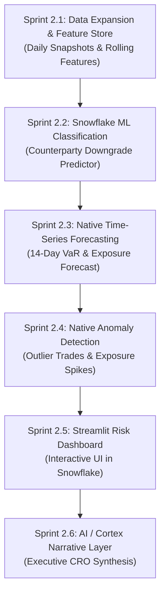

# 🚀 Phase 2 Architecture Blueprint & Strategy Guide: Advanced Snowflake ML, Forecasting & AI Integration

**Platform**: Institutional ABOR & Quantitative Risk Platform (`abor_risk`)  
**Phase**: Phase 2 — Machine Learning, Predictive Analytics & AI Integration  
**Execution Environment**: 100% Native Snowflake Compute (Snowpark ML, Model Registry, Native ML Functions)  
**Status**: Phase 2 Execution Active — Use Cases 1, 2, and 3 LIVE & VALIDATED in Snowflake

---

## 📌 Executive Summary & Philosophy

Phase 1 established a robust **Medallion Data Architecture (Bronze $\to$ Silver $\to$ Gold)**:
* **Bronze (`RAW`)**: Transient staging tables and data contract validation.
* **Silver (`ENG`)**: SCD Type 2 dimension masters, daily position/transaction ledgers, and a quantitative risk stored procedure calculating 99% VaR, 95% PFE, and CVA.
* **Gold (`ANALYTICS`)**: 5 live business consumption views providing portfolio risk metrics, counterparty concentrations, and trade turnover.

### Phase 2 Core Objectives:
1. **Predictive Intelligence**: Move from *historical reporting* (what happened yesterday) to *forward-looking forecasting* (what will happen over the next 14–30 days).
2. **Native Snowflake ML**: Leverage Snowflake’s built-in ML capabilities (`snowflake.ml.modeling`, `SNOWFLAKE.ML.FORECAST`, `SNOWFLAKE.ML.ANOMALY_DETECTION`, and Snowflake Model Registry).
3. **Patience & Step-by-Step Execution**: No premature or monolithic coding. Every task is divided into clear, manageable subtasks with full alignment before writing code.
4. **Zero Data Leakage / SCD Pitfalls**: Strict temporal separation between training data and future test data to prevent lookahead bias.
5. **Interactive Visualization**: Build a modern **Streamlit in Snowflake** dashboard as the central Risk Command Center.

---

## 🔍 Section 1: Data Readiness Assessment ("Do We Have Enough Data?")

To build trustworthy Machine Learning models, we must evaluate our current dataset honestly:

### 1. Current Data Inventory
* **`FACT_DAILY_POSITIONS_ABOR`**: 9 monthly snapshots (`2026-01-31` to `2026-09-30`), totaling ~25–30 rows per month ($\approx 250$ total rows).
* **`FACT_SETTLED_TRANSACTIONS`**: 343 trade executions spread across 9 months.
* **`DIM_COUNTERPARTY`**: 11 counterparties with SCD Type 2 rating migrations.
* **`RAW.RAW_FACTOR_RETURNS`**: 250 daily historical factor returns.

### 2. The Verdict for Machine Learning & Forecasting

| Model Type | Minimum Required Data | Current Data | Verdict & Impact |
| :--- | :--- | :--- | :---: |
| **Time-Series Forecasting** (`SNOWFLAKE.ML.FORECAST`) | **60 to 180+ sequential points** to capture trend, seasonality, and momentum. | 9 monthly points | ❌ **INSUFFICIENT**<br>Cannot detect meaningful curves from 9 points. |
| **Supervised Classification** (Downgrade Risk Predictor) | **1,000+ observations** for reliable train/val/test splits without overfitting. | ~250 position records | ⚠️ **MARGINAL**<br>High risk of model memorization. |
| **Anomaly Detection** (`SNOWFLAKE.ML.ANOMALY_DETECTION`) | **100+ baseline observations per entity** to establish normal behavior bands. | ~30 trades per month | ⚠️ **MARGINAL**<br>Baseline distribution is too thin. |

---

### 3. The Recommended Solution: Daily Business Snapshots
Because our data generators ([`fileGeneration/`](file:///d:/Padai/My_Project/Snowflake_Risk_project/abor_risk/fileGeneration/)) are Python scripts that we fully control, we will upgrade them:

* **Upgrade**: Change generation frequency from **Monthly** to **Daily Business Days (Monday–Friday)** across the 9 months (`2026-01-01` to `2026-09-30`).
* **Expected Dataset Scale**:
  * **~180 business dates** $\times 25$ positions = **~4,500 daily position records**.
  * **~2,500 to ~3,500 settled transactions**.
  * Complete, continuous 180-day time-series curve for every portfolio and counterparty.
* **Why this is ideal**:
  1. Provides ample sequential depth for `SNOWFLAKE.ML.FORECAST` (180 daily points is perfect for a 14-day forward forecast).
  2. Provides 4,500 rows for Supervised ML (allowing a 70% train / 15% validation / 15% out-of-sample test split).
  3. No external data dependency—everything remains 100% reproducible and governed.

---

## 🎯 Section 2: Phase 2 Problem Formulations

```text
┌────────────────────────────────────────────────────────────────────────────────────────┐
│                        PHASE 2 FIVE-PILLAR ADVANCED ANALYTICS                          │
└────────────────────────────────────────────────────────────────────────────────────────┘

  [ PILLAR 1: CLASSIFICATION ] ─────► Predict Counterparty Credit Rating Downgrade
                                      "Will this broker experience a credit downgrade in the next 30 days?"
                                      Engine: Snowpark ML (XGBoost / Random Forest Classifier)

  [ PILLAR 2: TIME-SERIES ]    ─────► Forecast Portfolio 99% VaR & MTM Exposure
                                      "What will our portfolio loss exposure and VaR look like over the next 14 days?"
                                      Engine: Snowflake Native SNOWFLAKE.ML.FORECAST

  [ PILLAR 3: ANOMALY DETECTION ] ──► Detect Unusual Exposure Spikes & Trade Outliers
                                      "Is this transaction or sudden counterparty concentration anomalous?"
                                      Engine: Snowflake Native SNOWFLAKE.ML.ANOMALY_DETECTION

  [ PILLAR 4: VISUALIZATION ]  ─────► Risk Command Center (Streamlit in Snowflake)
                                      Interactive UI displaying portfolio metrics, forecast curves, and alert badges.
                                      Engine: Streamlit in Snowflake (SiS)

  [ PILLAR 5: AI NARRATIVE ]   ─────► Automated CRO Risk Commentary
                                      Synthesize ML predictions, forecast curves, and anomaly alerts into executive text.
                                      Engine: Snowflake Cortex COMPLETE / Analytical Prompt Engine
```

---

## 🛡 Section 3: Guardrails to Avoid Past Pitfalls & SCD Issues

To ensure rock-solid stability and prevent subtle financial data bugs:

### 1. Chronological Splitting (Never Random Shuffle)
* **The Danger**: In standard machine learning (e.g. image recognition), you shuffle rows randomly. In **finance**, shuffling causes **Lookahead Bias** (training on data from September to predict an event in February).
* **The Rule**: All training and test splits will be strictly chronological:
  * **Training Window**: `2026-01-01` to `2026-06-30` (Months 1–6: ~125 business days).
  * **Validation Window**: `2026-07-01` to `2026-08-15` (Mid-year: ~30 business days).
  * **Out-of-Sample Test Window**: `2026-08-16` to `2026-09-30` (Final 1.5 months: ~30 business days).

### 2. Point-in-Time Dimension Feature Joining (SCD Type 2 Safety)
* **The Danger**: If a model evaluates a position on `2026-02-15`, it must **never** see a counterparty credit rating that was updated on `2026-05-01`.
* **The Rule**: All feature engineering views must join dimensions using:
  ```sql
  ON pos.COUNTERPARTY_ID = c.COUNTERPARTY_ID
  AND pos.POSITION_DATE BETWEEN c.EFFECTIVE_START_DATE AND c.EFFECTIVE_END_DATE
  ```
  This guarantees historical point-in-time truth without temporal leakage.

### 3. 100% In-Snowflake Compute
* **The Danger**: Pulling millions of rows to local Python memory causes memory crashes and data exfiltration security risks.
* **The Rule**: All ML training and scoring will run inside Snowflake's virtual warehouses using **Snowpark ML** (`snowflake.ml.modeling`) and native SQL stored procedures.

---

## 🗺 Section 4: Phase 2 Granular Sprint-by-Sprint Task List



---

### 📌 Sprint 2.1: Data Expansion & ML Feature Engineering
* [x] **Subtask 2.1.1**: Update synthetic data generators to produce **daily business snapshots** (Monday–Friday) from `2026-01-01` to `2026-09-30`.
* [x] **Subtask 2.1.2**: Ingest the expanded daily dataset into `ENG.FACT_DAILY_POSITIONS_ABOR` and `ENG.FACT_SETTLED_TRANSACTIONS`.
* [x] **Subtask 2.1.3**: Execute stored procedure `ENG.SP_CALCULATE_DAILY_RISK_METRICS` across all 195 daily business dates (9,750 rows).
* [x] **Subtask 2.1.4**: Build the ML Feature Store views `ANALYTICS.VW_ML_CPTY_DOWNGRADE_FEATURES` and `VW_ML_VAR_ANOMALY_FEATURES`.

---

### 📌 Sprint 2.2: Counterparty Rating Downgrade Early Warning (Use Case 3)
* [x] **Subtask 2.2.1**: Formulate the binary prediction target label (`IS_DOWNGRADE_RISK = 1` if worst rating in next 30 days > current rating).
* [x] **Subtask 2.2.2**: Prepare chronological train/val/test splits (`2026-01-01` to `2026-09-30`).
* [x] **Subtask 2.2.3**: Train balanced `RandomForestClassifier` inside Snowflake virtual warehouse (`1_train_downgrade_model.py`).
* [x] **Subtask 2.2.4**: Validation sweep calibrating optimal threshold $P^* = 0.45$ (`2_validate_downgrade_model.py`, AUC: `0.7493`).
* [x] **Subtask 2.2.5**: Log model artifact and optimal cutoff in `ANALYTICS.FACT_MODEL_STORE`.
* [x] **Subtask 2.2.6**: Holdout out-of-sample test (AUC: `0.7302`) and batch forward scoring for 50 counterparties into `ANALYTICS.FACT_COUNTERPARTY_DOWNGRADE_PREDICTIONS` (`3_test_and_score_inference.py`).

---

### 📌 Sprint 2.3: VaR Anomaly & Backtesting Exception Detector (Use Case 1)
* [x] **Subtask 2.3.1**: Build multidimensional feature space (P&L, VaR 99%, Volatility, Concentration).
* [x] **Subtask 2.3.2**: Fit in-database `IsolationForest` anomaly detector.
* [x] **Subtask 2.3.3**: Basel III traffic-light backtesting exception attribution ($P\&L < -\text{VaR}_{99}$).
* [x] **Subtask 2.3.4**: Persist anomaly scores and regimes into `ANALYTICS.FACT_VAR_ANOMALY_ALERTS`.

---

### 📌 Sprint 2.4: Systemic Contagion & Liquidity Shock Simulator (Use Case 2)
* [x] **Subtask 2.4.1**: Build interconnected counterparty balance sheet and bilateral exposure matrix.
* [x] **Subtask 2.4.2**: Implement multi-round domino failure cascade algorithm.
* [x] **Subtask 2.4.3**: Quantify Direct vs. Secondary Contagion Deficit.
* [x] **Subtask 2.4.4**: Persist cascade rounds into `ANALYTICS.FACT_CONTAGION_SIMULATION_RESULTS`.

---

### 📌 Sprint 2.5: Interactive Streamlit Risk Command Center (SiS — Completed ✅)
* [x] **Subtask 2.5.1**: Initialize the Streamlit app script (`abor_risk/streamlit/risk_dashboard.py`, `styles.py`, `data_service.py`).
* [x] **Subtask 2.5.2**: Build **Tab 1: Executive Portfolio Overview**:
  * KPI metric cards (Total AUM, 99% VaR, PFE, CVA, VaR/AUM %, PnL).
  * Portfolio breakdown charts & 14-day forward VaR trajectory forecast with 95% CI bands.
* [x] **Subtask 2.5.3**: Build **Tab 2: Systemic Contagion & Shock Simulator**:
  * Interactive stress shock sliders (LGD %, Fire-sale discount %).
  * Eisenberg-Noe / Glasserman domino cascade rounds & loss waterfall (`contagion_engine.py`).
* [x] **Subtask 2.5.4**: Build **Tab 3: Counterparty Downgrade Radar & Alerts**:
  * Basel Large Exposure status gauges & regulatory warning lines.
  * ML Downgrade Risk probability rankings & 4-tier operational action matrix.
* [x] **Subtask 2.5.5**: Build **Tab 4: Real-time Anomaly Surveillance** & **Tab 5: AI Narrative / Audit Telemetry**.
* [x] **Subtask 2.5.6**: Deploy natively to Snowflake Stage `@ENG.STREAMLIT_STAGE` as `ANALYTICS.RISK_COMMAND_CENTER` (`deploy_sis.py`).

---

### 📌 Sprint 2.6: AI / Cortex Narrative Integration
* [ ] **Subtask 2.6.1**: Design a structured prompt synthesizer that aggregates:
  * Top portfolio risk metrics.
  * Highest predicted counterparty downgrade risks from Sprint 2.2.
  * 14-day forecasted VaR trajectory from Sprint 2.3.
  * Active anomaly flags from Sprint 2.4.
* [ ] **Subtask 2.6.2**: Invoke Snowflake Cortex LLM (`SNOWFLAKE.CORTEX.COMPLETE`) or provide a structured rule-based fallback to generate an automated executive Chief Risk Officer (CRO) daily briefing.

---

## 📖 Section 5: Snowflake ML Beginner's Primer

Because you are new to AI/ML in Snowflake, here is a quick reference guide explaining the core tools we will be using:

### 1. What is Snowpark ML (`snowflake.ml.modeling`)?
* **Traditional Python**: You download data from the database to your laptop, run scikit-learn, and your laptop runs out of RAM.
* **Snowpark ML**: You write standard Python scikit-learn/XGBoost code, but the training runs **inside Snowflake's cloud compute nodes**. Data never leaves Snowflake, and it scales to millions of rows automatically.

### 2. What is the Snowflake Model Registry (`snowflake.ml.registry`)?
* Think of it as a **Git repository for Machine Learning models**.
* When you finish training a model, you register it with a version name (e.g., `CPTY_DOWNGRADE_XGB_V1`).
* Once registered, anyone in your organization can call the model directly using standard SQL:
  ```sql
  SELECT cpty_id, CPTY_DOWNGRADE_XGB_V1!PREDICT(features) FROM table;
  ```

### 3. What are Snowflake Native ML Functions (`SNOWFLAKE.ML.FORECAST` & `ANOMALY_DETECTION`)?
* You don't need to write manual statistical math (like ARIMA or Prophet). Snowflake provides **pre-built, managed ML functions** optimized directly for Snowflake tables. You point them at your table, specify the target column and date column, and Snowflake handles the underlying modeling automatically.

### 4. What is Streamlit in Snowflake (SiS)?
* Streamlit is a Python framework that turns data scripts into interactive web dashboards.
* **Streamlit in Snowflake** allows us to deploy the dashboard **inside your Snowflake account** with zero web servers, zero Docker containers, and enterprise role-based security.

---

## 🚦 Phase 2 Alignment & Sign-Off Checklist

Before starting Sprint 2.1, please review and confirm:
1. **Scope Confirmation**: Does the 5-pillar scope (Classification + Forecasting + Anomaly Detection + Streamlit + AI) cover everything you envision for Phase 2?
2. **Data Expansion**: Are you aligned with upgrading synthetic data generation to **daily business days (~180 dates, ~4,500 position rows)** so our ML models have solid historical depth?
3. **Execution Pace**: We will tackle each subtask one by one, verifying each step before proceeding to the next.
