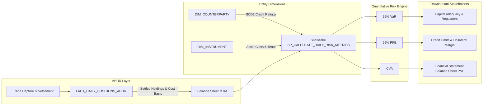
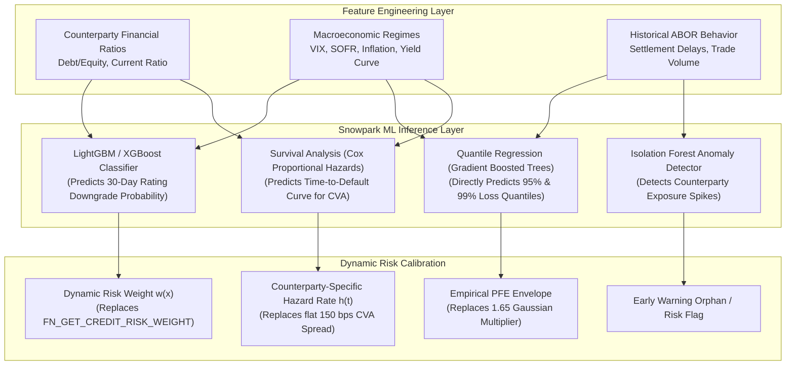

# 📐 Quantitative Risk Engine: Mathematical Foundations, Business Logic & ML Calibration Guide

---

## 📌 Executive Summary

In institutional finance, prime brokerage, and capital management, risk systems must answer three fundamental questions for every asset on the balance sheet:
1. **Short-Term Downside**: *What is the most we could lose tomorrow under severe market stress?* $\rightarrow$ **Value-at-Risk (99% VaR)**
2. **Counterparty Horizon Exposure**: *If a trading counterparty goes bankrupt before contracts settle, how large could our unhedged replacement cost become?* $\rightarrow$ **Potential Future Exposure (95% PFE)**
3. **Fair Value Accounting Discount**: *How much must we write down the book value of our holdings today to account for counterparty default risk under IFRS 13 / US GAAP?* $\rightarrow$ **Credit Value Adjustment (CVA)**

This document breaks down the business theory, analyzes the existing closed-form SQL formulas implemented in [`create_risk_procedure.py`](file:///d:/Padai/My_Project/Snowflake_Risk_project/abor_risk/riskEngine/procedure/create_risk_procedure.py), and outlines how **mathematical modeling** and **machine learning engineering** can dynamically calibrate and elevate these metrics from static proxies to an enterprise-grade quantitative risk platform.

---

## 🏛️ Business Context: ABOR vs. Quantitative Risk



* **Accounting Book of Record (ABOR)**: Records the authoritative, settled transactions and positions. It is backward-looking and transactional.
* **Risk Engine**: Takes settled ABOR holdings, blends them with active counterparty credit ratings (`DIM_COUNTERPARTY`), and evaluates prospective loss distributions across future economic states.

---

## 🔬 Deconstruction of the 3 Implemented Formulas

### 1. The Credit Risk Weight Mapping (`ENG.FN_GET_CREDIT_RISK_WEIGHT`)

The function in [`create_risk_weight_udf.py`](file:///d:/Padai/My_Project/Snowflake_Risk_project/abor_risk/riskEngine/function/create_risk_weight_udf.py) assigns a risk weight $w$ based on external credit ratings:

$$w(\text{Rating}) = \begin{cases} 
0.04 & \text{AAA} \\ 
0.06 & \text{AA} \\ 
0.09 & \text{A} \\ 
0.13 & \text{BBB} \\ 
0.22 & \text{BB} \\ 
0.28 & \text{B} \\ 
0.35 & \text{CCC / Other} 
\end{cases}$$

#### Financial Rationale (Basel SA-CCR Framework)
* **Standardized Approach for Counterparty Credit Risk (SA-CCR)**: Regulators (BIS / Federal Reserve / EBA) mandate that institutions without internal model approvals assign standardized supervisory risk factors.
* Investment-grade counterparties (`AAA` through `BBB`) experience historical 1-year cumulative default rates between **0.01% and 0.18%**.
* Speculative/junk counterparties (`BB` through `CCC`) experience historical 1-year default rates of **1.2% to 28.0%**. The jump in risk weight from $0.13 \rightarrow 0.22 \rightarrow 0.35$ reflects this exponential default probability curvature.

---

### 2. 99% Value-at-Risk (`VALUE_AT_RISK_99`)

$$\text{VaR}_{0.99} = |\text{Market Value}| \times w(\text{Rating}) \times 1.10$$

```sql
ROUND(ABS(p.MARKET_VALUE * ENG.FN_GET_CREDIT_RISK_WEIGHT(c.CREDIT_RATING) * 1.1), 2)
```

| Component | Financial Meaning | Mathematical Role |
| :--- | :--- | :--- |
| `ABS(p.MARKET_VALUE)` | Net economic exposure | Absolute dollar scale factor; prevents negative signs from distorting capital loss magnitude. |
| `FN_GET_CREDIT_RISK_WEIGHT` | Credit risk factor ($w$) | Baseline annualized credit spread / default volatility proxy ($\sigma_{\text{credit}}$). |
| `1.10` | Institutional Stress Buffer | A $10\%$ add-on modeling **kurtosis (fat tails)** and a 1-day liquidation horizon liquidity premium under Basel III stressed market conditions. |

---

### 3. Potential Future Exposure (`POTENTIAL_FUTURE_EXPOSURE`)

$$\text{PFE}_{0.95} = \text{VaR}_{0.99} \times 1.65 = |\text{Market Value}| \times w(\text{Rating}) \times 1.10 \times 1.65$$

```sql
ROUND(ABS(p.MARKET_VALUE * ENG.FN_GET_CREDIT_RISK_WEIGHT(c.CREDIT_RATING) * 1.1) * 1.65, 2)
```

#### Why $1.65$? (The 95% Gaussian Upper Bound)
In financial probability, if asset price changes $\Delta V$ over horizon $\Delta t$ follow a normal distribution $\mathcal{N}(0, \sigma^2)$:

$$P\left(\frac{X - \mu}{\sigma} \le Z_\alpha\right) = \alpha$$

* For $\alpha = 0.90 \implies Z = 1.282$
* **For $\alpha = 0.95 \implies Z = 1.645 \approx 1.65$**
* For $\alpha = 0.99 \implies Z = 2.326$

By multiplying the 1-day risk baseline by **$1.65$**, the engine estimates the **95th percentile upper-bound exposure** over the close-out window before a defaulted counterparty can be liquidated, collateral seized, or contracts novated.

---

### 4. Credit Value Adjustment (`CREDIT_VALUE_ADJUSTMENT`)

$$\text{CVA} = \text{PFE}_{0.95} \times 0.015$$

```sql
ROUND(ABS(p.MARKET_VALUE * ENG.FN_GET_CREDIT_RISK_WEIGHT(c.CREDIT_RATING) * 1.65) * 0.015, 2)
```

#### Accounting & Financial Meaning (IFRS 13 & Basel III)
* In continuous financial mathematics:
  $$\text{CVA} = (1 - R) \int_0^T D(t) \cdot \mathbb{E}[\max(V(t), 0)] \cdot d\text{PD}(t)$$
  Where:
  * $R$ = Recovery Rate ($\approx 40\%$, so Loss Given Default $\text{LGD} = 1 - R \approx 60\%$).
  * $D(t)$ = Discount factor.
  * $\mathbb{E}[\max(V(t), 0)]$ = Expected Exposure ($\text{EE}$).
  * $\text{PD}(t)$ = Cumulative Probability of Default.

* In our discrete closed-form proxy:
  * $\text{Exposure} \approx \text{PFE}_{0.95}$ (peak exposure envelope).
  * $\text{Credit Spread} \approx 0.015 = 150 \text{ basis points}$.
  * Since Credit Spread $S \approx \text{LGD} \times \text{PD}$, the flat $0.015$ multiplier represents the standard market proxy for corporate counterparty credit default swap (CDS) spreads.

---

## 📊 Summary of Assumptions in the Current Model

| Parameter | Current Value | Underlying Assumption | Real-World Limitation |
| :--- | :--- | :--- | :--- |
| **Credit Weights** | `0.04` to `0.35` | Ratings map to fixed regulatory bands. | Does not account for sudden rating downgrades or market distress between rating agency updates. |
| **Stress Buffer** | `1.10` | 10% fat-tail add-on covers market stress. | Stressed market moves (e.g. 2008, 2020) often exhibit $3\times$ to $5\times$ normal volatility. |
| **PFE Multiplier** | `1.65` | Gaussian (Normal) 95% critical value. | Assumes normal distribution; ignores heavy tails, skewness, and non-linear option payoffs. |
| **CVA Spread** | `0.015` (150 bps) | Constant 1.5% default spread across all counterparties. | High-risk counterparties (`CCC`) have spreads $>1,000\text{ bps}$, while `AAA` sovereigns trade $<20\text{ bps}$. |

---

## 🧠 Enhancing with Mathematical Analysis (Quantitative Methods)

Rather than using static hard-coded numbers, mathematical analysis can compute these parameters empirically from historical financial data:

```text
+---------------------------------------------------------------------------------------------------+
|                                   MATHEMATICAL UPGRADES                                           |
+--------------------------------------+------------------------------------------------------------+
| 1. Empirical Credit Migration Matrix | Derive default probabilities via Markov Transition Chains  |
| 2. Extreme Value Theory (EVT)        | Calibrate Generalized Pareto Distribution (GPD) tails      |
| 3. Geometric Brownian Motion (GBM)   | Simulate true dynamic Monte Carlo PFE exposure paths       |
| 4. Merton Structural Default Model   | Deduce Distance-to-Default (DD) from equity volatility     |
+--------------------------------------+------------------------------------------------------------+
```

### 1. Markov Chain Credit Transition Matrix
In our project, counterparties migrate ratings across the 9 months (`202601` to `202609`). We can compute the empirical transition probability matrix $\mathbf{P}$:

$$P_{ij} = \frac{N_{ij}}{N_i} = \mathbb{P}(\text{Rating}_{t+1} = j \mid \text{Rating}_t = i)$$

$$\mathbf{P} = \begin{pmatrix} 
P_{\text{AAA}\to\text{AAA}} & P_{\text{AAA}\to\text{AA}} & \dots & P_{\text{AAA}\to\text{Default}} \\
P_{\text{AA}\to\text{AAA}} & P_{\text{AA}\to\text{AA}} & \dots & P_{\text{AA}\to\text{Default}} \\
\vdots & \vdots & \ddots & \vdots \\
0 & 0 & \dots & 1 
\end{pmatrix}$$

**Outcome**: Instead of static `0.04`, the risk weight becomes a function of the exact 1-year cumulative default probability $P_{i \to \text{Default}}$ extracted from observed rating transitions.

---

### 2. Extreme Value Theory (EVT) for the Fat-Tail Buffer
Instead of fixing `1.10`, we can fit the **Pickands-Balkema-de Haan Theorem** (Generalized Pareto Distribution) to historical portfolio returns:

$$F_u(y) = \mathbb{P}(X - u \le y \mid X > u) \approx 1 - \left(1 + \frac{\xi y}{\beta}\right)^{-1/\xi}$$

Where $\xi$ is the shape parameter (tail heaviness).
* If $\xi = 0 \rightarrow$ Normal distribution (tail multiplier $= 1.0$).
* If $\xi > 0 \rightarrow$ Heavy-tailed Pareto behavior (tail multiplier calibrated directly to $\frac{1}{1 - \xi}$, typically between $1.15$ and $1.45$).

---

### 3. Merton Structural Model for Counterparty-Specific CVA
Instead of a flat $0.015$ credit spread for all counterparties, the **Merton (1974)** structural model views the counterparty's equity as a European call option on its underlying enterprise assets $V_A$:

$$\text{Distance to Default } (d_2) = \frac{\ln(V_A / D) + (\mu_A - 0.5 \sigma_A^2)T}{\sigma_A \sqrt{T}}$$

$$\text{Default Probability } (\text{PD}) = \Phi(-d_2)$$

* $V_A$: Total firm assets.
* $D$: Face value of debt (liabilities).
* $\sigma_A$: Volatility of asset returns.

**Outcome**: Each counterparty receives a custom, dynamic default probability $\Phi(-d_2)$ reflecting its true balance sheet leverage.

---

## 🤖 Enhancing with Machine Learning Engineering

Machine learning can solve non-linearities and multi-factor interactions that static formulas miss:



### 1. Quantile Regression for PFE (Replacing $1.65$)
Standard linear regression estimates the conditional mean $\mathbb{E}[Y \mid X]$. **Quantile Regression** minimizes the tilted pinball loss:

$$\mathcal{L}_\tau(y, \hat{y}) = \sum_{i: y_i \ge \hat{y}_i} \tau |y_i - \hat{y}_i| + \sum_{i: y_i < \hat{y}_i} (1 - \tau) |y_i - \hat{y}_i|$$

* Setting $\tau = 0.95$ directly outputs the **95th percentile peak exposure surface** as a function of instrument maturity, asset class volatility, and market regime without requiring normal distribution assumptions.

### 2. Gradient Boosted Trees for Rating Migration & Default Hazard
* **Target**: Probability that a counterparty is downgraded within the next 90 days ($P(\text{Downgrade}) \in [0, 1]$).
* **Features**:
  * Historical days-to-settlement from `FACT_SETTLED_TRANSACTIONS`.
  * Total outstanding gross notional with the institution.
  * Sector, jurisdiction, and macroeconomic indicators (credit spreads, interest rate yield slope).
* **Snowpark Integration**: Train model locally or via Snowpark ML, register as a Python UDF `ENG.UDF_PREDICT_CREDIT_HAZARD()`, and call it directly inside the stored procedure.

---

## 🗺️ Progressive Roadmap: From Static Proxy to ML-Driven Risk

```text
+----------------------------------------------------------------------------------------------------+
| MILESTONE 1 (Current State)                                                                        |
| -> Static Basel SA-CCR risk weight UDF (0.04 to 0.35)                                              |
| -> Static 1.10 stress buffer, 1.65 Gaussian PFE factor, 0.015 CVA credit spread                   |
+----------------------------------------------------------------------------------------------------+
                                                │
                                                ▼
+----------------------------------------------------------------------------------------------------+
| MILESTONE 2 (Mathematical Calibration)                                                             |
| -> Derive empirical transition probabilities from DIM_COUNTERPARTY 9-month history                 |
| -> Calculate dynamic 1-day portfolio return volatility (GARCH(1,1)) from factor returns             |
| -> Replace 0.015 with sector-specific credit spread curves (Financials vs Energy vs Tech)         |
+----------------------------------------------------------------------------------------------------+
                                                │
                                                ▼
+----------------------------------------------------------------------------------------------------+
| MILESTONE 3 (Machine Learning in Snowpark)                                                         |
| -> Train Quantile Regression model on multi-month exposures for non-parametric PFE                 |
| -> Deploy Snowpark Python UDF scoring counterparty downgrade probability in real time              |
| -> Implement automated Isolation Forest alerting on anomalous portfolio credit concentrations      |
+----------------------------------------------------------------------------------------------------+
```

---

## 💡 Practical Recommendation

1. **Keep the current Stored Procedure as the baseline benchmark**: The current formulas align with regulatory Standardized Approaches (SA-CCR / Basel III). They provide a transparent, audit-compliant benchmark that any external regulator or auditor can verify instantly.
2. **Phase in calibration dynamically**:
   * Calculate empirical credit migration rates from our generated dataset (`202601`–`202609`).
   * Parameterize the stored procedure arguments (e.g. allowing `stress_buffer`, `confidence_z`, and `credit_spread` to be passed from a configuration table rather than hardcoded in the SQL).
3. **Add Snowpark ML for predictive credit alerts**: Use Python Snowpark to predict rating downgrades before they are finalized in the dimension table.

---

## 📺 Recommended Learning Resources & Video Lectures

For a deeper dive into the quantitative finance, accounting standards, and computational modeling behind these metrics, here are the most authoritative tutorials and industry lectures:

### 1. Intuitive & Practical Walkthroughs (Start Here)
* **Master Counterparty Credit Risk in Excel: EPE, ENE, PFE & EE Explained**  
  * **Channel / Author**: *Ryan O'Connell, CFA, FRM*  
  * **Focus**: Graphs exposure profiles across trade lifecycles in Excel; visually demonstrates why PFE is the 95th/99th percentile peak envelope.
* **CVA (Counterparty Valuation Adjustment) Explained**  
  * **Channel / Author**: *BISP Trainings*  
  * **Focus**: Step-by-step mechanics of CVA: Expected Exposure ($\text{EE}$), Probability of Default ($\text{PD}$), and Loss Given Default ($\text{LGD}$) calculations.

### 2. Institutional Foundations & Risk Masterclasses
* **Counterparty Risk, Credit Exposure and CVA**  
  * **Channel / Author**: *Dr. Jon Gregory* (Author of *"The xVA Challenge: Counterparty Risk, Funding, Collateral and Capital"*)  
  * **Focus**: Why global tier-1 investment banks (Jefferies, Goldman, Citi) mandated bilateral CVA and PFE after the 2008 Lehman default.
* **Counterparty Credit Risk (CCR) & Value at Risk (VaR) Series**  
  * **Channel / Author**: *Bionic Turtle* (David Harper)  
  * **Focus**: The gold-standard FRM preparation playlist covering Parametric vs. Historical Simulation VaR, SA-CCR capital formulas, and CreditMetrics migration models.
* **Credit Value at Risk (Credit VaR) & Vasicek Model**  
  * **Channel / Author**: *MidhaFin / Financial Risk*  
  * **Focus**: Credit transition matrices and mapping rating migrations (`AAA` $\to$ `BBB` $\to$ `Default`) to portfolio loss distributions.

### 3. Quantitative Math & Machine Learning
* **Financial Engineering: Value-at-Risk, Expected Shortfall, and Exposure Diffusion**  
  * **Channel / Author**: *Prof. Lech Grzelak* (Delft University of Technology / Quantitative Finance)  
  * **Focus**: Stochastic calculus, Monte Carlo paths, and heavy-tail modeling for quant developers.
* **SA-CCR & Machine Learning in Risk Webinars**  
  * **Channel / Author**: *Risk.net*  
  * **Focus**: Modern applications of machine learning in credit risk modeling, regulatory capital under Basel IV, and real-time margin valuation.

### 🔍 Quick Search Term Reference for Deep Dives
* `SA-CCR capital calculation tutorial` *(Standardized Approach for Counterparty Credit Risk)*
* `Monte Carlo PFE exposure simulation Python`
* `Credit Value Adjustment CVA formula explained`
* `Machine learning for credit risk transition matrices`

