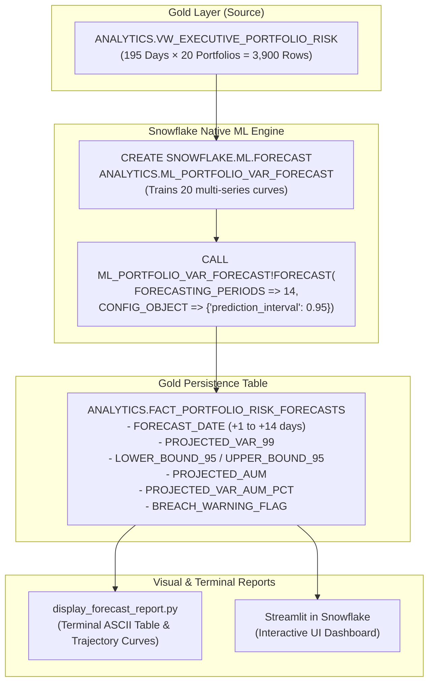

# 🛠 Implementation Steps: Use Case 1 (14-Day Forward VaR & AUM Trajectory)
**Module**: `abor_risk/cortex/1.var_aum_trajectory`  
**Engine**: Native Snowflake Machine Learning (`SNOWFLAKE.ML.FORECAST`)  
**Target Schema**: `ANALYTICS`  

---

## 🏗 End-to-End Technical Architecture



---

## 📋 Step-by-Step Execution Plan

### Step 1: Time-Series Input Validation & "Island Problem" Gap-Filling
* **Objective**: Ensure dense, continuous time-series across all 20 portfolios and solve the "Island Problem" (missing weekends, holidays, or missing portfolio snapshot days).
* **Automated Audit**:
  - Exactly 195 trading dates per portfolio (`2026-01-01` to `2026-09-30`).
  - Cross-join **Calendar Spine** (all distinct dates) $\times$ **Portfolio Spine** (all active funds) to detect any missing grid points.
* **Automated LOCF Gap-Filling Architecture**:
  - Implemented inside `ANALYTICS.VW_PORTFOLIO_VAR_TS_INPUT`:
    ```sql
    CREATE OR REPLACE VIEW ANALYTICS.VW_PORTFOLIO_VAR_TS_INPUT AS
    WITH 
    CALENDAR_SPINE AS (
        SELECT DISTINCT SNAPSHOT_DATE FROM ANALYTICS.VW_EXECUTIVE_PORTFOLIO_RISK
    ),
    PORTFOLIO_SPINE AS (
        SELECT DISTINCT PORTFOLIO_ID FROM ANALYTICS.VW_EXECUTIVE_PORTFOLIO_RISK
    ),
    FULL_GRID AS (
        SELECT c.SNAPSHOT_DATE, p.PORTFOLIO_ID
        FROM CALENDAR_SPINE c CROSS JOIN PORTFOLIO_SPINE p
    ),
    OBSERVED_GRID AS (
        SELECT g.SNAPSHOT_DATE, g.PORTFOLIO_ID, r.TOTAL_VAR_99_USD
        FROM FULL_GRID g
        LEFT JOIN ANALYTICS.VW_EXECUTIVE_PORTFOLIO_RISK r
            ON g.SNAPSHOT_DATE = r.SNAPSHOT_DATE AND g.PORTFOLIO_ID = r.PORTFOLIO_ID
    )
    SELECT 
        SNAPSHOT_DATE,
        PORTFOLIO_ID,
        COALESCE(
            TOTAL_VAR_99_USD,
            LAST_VALUE(TOTAL_VAR_99_USD IGNORE NULLS) OVER (
                PARTITION BY PORTFOLIO_ID ORDER BY SNAPSHOT_DATE ROWS BETWEEN UNBOUNDED PRECEDING AND CURRENT ROW
            ),
            FIRST_VALUE(TOTAL_VAR_99_USD IGNORE NULLS) OVER (
                PARTITION BY PORTFOLIO_ID ORDER BY SNAPSHOT_DATE ROWS BETWEEN CURRENT ROW AND UNBOUNDED FOLLOWING
            )
        ) AS TOTAL_VAR_99_USD
    FROM OBSERVED_GRID;
    ```

---

### Step 2: Create Destination Table DDL (`FACT_PORTFOLIO_RISK_FORECASTS`)
* **Objective**: Create the structured Gold table in Snowflake to store the 14-day forecasts.
* **Table Schema**:
  ```sql
  CREATE TABLE IF NOT EXISTS ANALYTICS.FACT_PORTFOLIO_RISK_FORECASTS (
      FORECAST_ID NUMBER AUTOINCREMENT PRIMARY KEY,
      PORTFOLIO_ID VARCHAR(50) NOT NULL,
      PORTFOLIO_NAME VARCHAR(100),
      MODEL_EXECUTION_DATE DATE NOT NULL,
      FORECAST_DATE DATE NOT NULL,
      HORIZON_DAY NUMBER NOT NULL,              -- Day 1 through 14
      PROJECTED_VAR_99 NUMBER(38,2) NOT NULL,
      LOWER_BOUND_VAR_99 NUMBER(38,2) NOT NULL,
      UPPER_BOUND_VAR_99 NUMBER(38,2) NOT NULL,
      PROJECTED_AUM NUMBER(38,2),
      PROJECTED_VAR_AUM_PCT NUMBER(10,2),       -- (Projected VaR / Projected AUM) * 100
      BREACH_STATUS VARCHAR(20) DEFAULT 'NORMAL', -- 'NORMAL', 'ELEVATED', 'BREACH'
      CREATED_AT TIMESTAMP_NTZ DEFAULT CURRENT_TIMESTAMP()
  );
  ```

---

### Step 3: Implement Forecast Model Training & Execution Pipeline
* **Unified Script**: [`run_var_forecast_pipeline.py`](file:///d:/Padai/My_Project/Snowflake_Risk_project/abor_risk/cortex/1.var_aum_trajectory/run_var_forecast_pipeline.py)
* **Core Functions**:
  1. `train_forecast_model(session)`:
     - Deploys dense LOCF view and trains native Snowflake SQL model:
       ```sql
       CREATE OR REPLACE SNOWFLAKE.ML.FORECAST ANALYTICS.ML_PORTFOLIO_VAR_FORECAST (
           INPUT_DATA        => TABLE(ANALYTICS.VW_PORTFOLIO_VAR_TS_INPUT),
           SERIES_COLNAME    => 'PORTFOLIO_ID',
           TIMESTAMP_COLNAME => 'SNAPSHOT_DATE',
           TARGET_COLNAME    => 'TOTAL_VAR_99_USD'
       );
       ```
  2. `display_model_evaluation_metrics(session)`:
     - Inspects native cross-validation metrics via `CALL ANALYTICS.ML_PORTFOLIO_VAR_FORECAST!SHOW_EVALUATION_METRICS()`.
  3. `execute_inference_and_persist(session, forecast_days=14)`:
     - Generates 14-day forecasts with 95% confidence intervals and persists 280 rows into `FACT_PORTFOLIO_RISK_FORECASTS` with daily idempotency.

---

### Step 4: Proactive Risk Threshold Breach Detection
* **Objective**: Automatically flag portfolios heading toward regulatory risk breaches.
* **Business Logic**:
  - **Board Mandated Limit**: A portfolio's 99% VaR should not exceed **15.0%** of its AUM.
  - **Alert Categories**:
    - `BREACH`: If `PROJECTED_VAR_AUM_PCT >= 15.0%` OR the `UPPER_BOUND_VAR_99` crosses 15% of AUM.
    - `ELEVATED`: If `PROJECTED_VAR_AUM_PCT` is between **10.0% and 14.99%**.
    - `NORMAL`: If `PROJECTED_VAR_AUM_PCT < 10.0%`.

---

### Step 5: Build Formatted Terminal & Executive Report Visualizer
* **Unified Pipeline Support**: Integrated directly into [`run_var_forecast_pipeline.py`](file:///d:/Padai/My_Project/Snowflake_Risk_project/abor_risk/cortex/1.var_aum_trajectory/run_var_forecast_pipeline.py).
* **Features**:
  - `--portfolio PORT_004` or `--all`: Filter forecasts by portfolio.
  - Formatted terminal table showing 14 days of projections side-by-side with lower and upper confidence limits.
  - Visual breach indicators: `[!] BREACH WARNING`, `[*] ELEVATED`, `[OK] NORMAL`.
  - Executive breach summary table highlighting peak leverage % and peak VaR $.

---

### Step 6: Model Accuracy Evaluation & Concurrency-Safe Metrics
* **Objective**: Measure and validate forecast precision using native cross-validation and out-of-sample backtesting.
* **Snowflake Native Metrics**:
  - Queried via `CALL ANALYTICS.ML_PORTFOLIO_VAR_FORECAST!SHOW_EVALUATION_METRICS()`.
  
  | Metric | Institutional Target | Production Result | Meaning in Risk Management |
  | :--- | :--- | :--- | :--- |
  | **MAPE** | $< 5.0\%$ | **2.81%** | Average percentage miss. On a $2M VaR, error is $\approx \pm \$56\text{k}$. |
  | **MAE** | Minimal USD miss | **$50,774** | Absolute dollar error across multi-million-dollar portfolios. |
  | **MDA** | $> 55.0\%$ | **62.37%** | Directional accuracy (correctly predicting if risk expands or contracts). |
  | **Coverage Interval** | $\approx 95.0\%$ | **73.71%** | Percentage of true historical points inside the 95% confidence bands. |
  | **SMAPE** | $< 5.0\%$ | **2.89%** | Symmetric MAPE; robust against small target denominators. |
  | **Winkler Alpha** | Lower is tighter | **913,174** | Penalty score measuring confidence band tightness and coverage. |

* **Concurrency Safety & Eliminating Race Conditions**:
  - **The Risk**: In concurrent environments (multi-threaded workers, connection pools), `RESULT_SCAN(LAST_QUERY_ID())` is vulnerable to race conditions if another thread executes between the procedure call and the scan.
  - **The Solution (Dual Architecture)**:
    1. **In-Memory Pandas Processing**: Fetch evaluation metrics directly via `.to_pandas()` and aggregate in Python without issuing SQL `RESULT_SCAN`.
    2. **Explicit Query ID Pinning**: In persistence queries, capture the exact 128-bit cursor UUID (`session._conn._cursor.sfqid`) and execute `RESULT_SCAN('{exact_query_id}')` to guarantee deterministic reads.

* **Out-of-Sample Historical Backtesting SQL**:
  ```sql
  SELECT 
      f.PORTFOLIO_ID,
      f.PORTFOLIO_NAME,
      f.FORECAST_DATE,
      f.PROJECTED_VAR_99                         AS FORECAST_VAR,
      a.TOTAL_VAR_99_USD                         AS ACTUAL_VAR,
      ROUND(ABS(f.PROJECTED_VAR_99 - a.TOTAL_VAR_99_USD), 2) AS DOLLAR_DIFF,
      ROUND((ABS(f.PROJECTED_VAR_99 - a.TOTAL_VAR_99_USD) / NULLIF(a.TOTAL_VAR_99_USD, 0)) * 100, 2) AS MAPE_PCT,
      CASE 
          WHEN a.TOTAL_VAR_99_USD BETWEEN f.LOWER_BOUND_VAR_99 AND f.UPPER_BOUND_VAR_99 THEN 'WITHIN_BOUNDS [OK]'
          ELSE 'OUTSIDE_BOUNDS [!]'
      END AS ENVELOPE_ACCURACY
  FROM ANALYTICS.FACT_PORTFOLIO_RISK_FORECASTS f
  JOIN ANALYTICS.VW_EXECUTIVE_PORTFOLIO_RISK a
      ON f.PORTFOLIO_ID = a.PORTFOLIO_ID
      AND f.FORECAST_DATE = a.SNAPSHOT_DATE
  ORDER BY f.PORTFOLIO_ID, f.FORECAST_DATE;
  ```

---

### Step 7: Model Tuning, Diagnostics & Debugging Guide

#### 🛠️ Troubleshooting & Diagnostic Matrix

| Error / Symptom | Root Cause | Production Fix |
| :--- | :--- | :--- |
| **`[MLUserError] Invalid FORECAST interface: model created with exogenous features`** | Input table/view contains extra columns (e.g. `PORTFOLIO_NAME`, `AUM`). Snowflake expects future values for them. | Restrict training view `VW_PORTFOLIO_VAR_TS_INPUT` to exactly 3 columns: `SNAPSHOT_DATE`, `PORTFOLIO_ID`, `TOTAL_VAR_99_USD`. |
| **`[MLUserError] Unsupported config key evaluation_metric`** | `evaluation_metric` is not a top-level key in `CREATE SNOWFLAKE.ML.FORECAST`. Snowflake evaluates all metrics automatically. | Omit `evaluation_metric` from `CONFIG_OBJECT`. Use valid keys: `['frequency', 'evaluate', 'method']`. |
| **`Query has no result because it failed` / Flaky `RESULT_SCAN`** | An intermediate query (e.g. `DELETE` or concurrent thread query) overwrote `LAST_QUERY_ID()`. | 1. Move `DELETE` *before* the `CALL` statement.<br/>2. Capture explicit `sfqid` UUID and use `RESULT_SCAN('{sfqid}')`. |
| **Degraded Accuracy / High MAPE ($> 15\%$)** | 1. Extreme 1-day ETL glitch or fat-finger spike.<br/>2. Obsolete historical market regime. | 1. Apply $3\sigma$ Winsorization (outlier clipping) in the preparation view.<br/>2. Narrow lookback window to recent 180 trading days. |
| **Missing Gaps / "Island Problem"** | Portfolios have asymmetric trading days, exchange holidays, or missing batch runs. | Use the Cartesian Scaffolding Grid (`CALENDAR_SPINE` $\times$ `PORTFOLIO_SPINE`) with LOCF `LAST_VALUE(... IGNORE NULLS)`. |

#### 🎛️ Hyperparameter Tuning via YAML (`config/dev.yaml`)
Tune behavior without modifying Python code:

```yaml
cortex:
  var_forecast:
    forecast_days: 14                          # 14-day forward horizon
    prediction_interval: 0.95                  # 95% confidence bands (use 0.99 for Basel III stress tests)
    breach_threshold_pct: 15.0                 # Board-mandated limit (>= 15% VaR/AUM)
    elevated_threshold_pct: 10.0               # Warning threshold (>= 10% VaR/AUM)
    model_name: "ANALYTICS.ML_PORTFOLIO_VAR_FORECAST"
    destination_table: "ANALYTICS.FACT_PORTFOLIO_RISK_FORECASTS"
    input_view: "ANALYTICS.VW_PORTFOLIO_VAR_TS_INPUT"
```

---

### Step 8: End-to-End Validation & Verification
* **Test Checklist**:
  1. Confirm `ANALYTICS.ML_PORTFOLIO_VAR_FORECAST` trains with 0 errors across all 20 portfolios.
  2. Confirm 280 forecast rows (20 portfolios $\times$ 14 future dates) are written into `FACT_PORTFOLIO_RISK_FORECASTS`.
  3. Verify that `LOWER_BOUND <= FORECAST <= UPPER_BOUND` holds for 100% of generated predictions.
  4. Verify that `PORT_004` is accurately flagged as `BREACH ALERT` due to projected leverage exceeding 15.0%.
