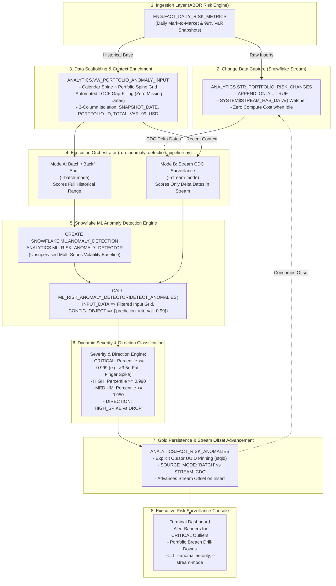

# 🛠 Implementation Steps: Use Case 2 (Real-Time Risk & Asset Anomaly Detection with Snowflake Streams)
**Module**: `abor_risk/cortex/2.anomaly_detection`  
**Engine**: Native Snowflake Machine Learning (`SNOWFLAKE.ML.ANOMALY_DETECTION`)  
**CDC Engine**: Native Snowflake Streams (`APPEND_ONLY = TRUE`)  
**Target Schema**: `ANALYTICS`  
**Destination Table**: `ANALYTICS.FACT_RISK_ANOMALIES`  
**Stream Object**: `ANALYTICS.STR_PORTFOLIO_RISK_CHANGES`  

---

## 🏗 End-to-End Technical Architecture



---

## 📋 Step-by-Step Technical Execution Plan

### Step 1: Input Data Preparation & Scaffolding View
* **Objective**: Ensure the anomaly detection model receives a continuous, dense time series with zero gaps (resolving the "Island Problem") and strictly isolated to 3 columns to avoid the exogenous feature trap.
* **SQL View**:
  ```sql
  CREATE OR REPLACE VIEW ANALYTICS.VW_PORTFOLIO_ANOMALY_INPUT AS
  WITH 
  CALENDAR_SPINE AS (
      SELECT DISTINCT SNAPSHOT_DATE FROM ANALYTICS.VW_EXECUTIVE_PORTFOLIO_RISK
  ),
  PORTFOLIO_SPINE AS (
      SELECT DISTINCT PORTFOLIO_ID FROM ANALYTICS.VW_EXECUTIVE_PORTFOLIO_RISK
  ),
  FULL_GRID AS (
      SELECT c.SNAPSHOT_DATE, p.PORTFOLIO_ID
      FROM CALENDAR_SPINE c CROSS JOIN PORTFOLIO_SPINE p
  ),
  OBSERVED_GRID AS (
      SELECT g.SNAPSHOT_DATE, g.PORTFOLIO_ID, r.TOTAL_VAR_99_USD
      FROM FULL_GRID g
      LEFT JOIN ANALYTICS.VW_EXECUTIVE_PORTFOLIO_RISK r
          ON g.SNAPSHOT_DATE = r.SNAPSHOT_DATE AND g.PORTFOLIO_ID = r.PORTFOLIO_ID
  )
  SELECT 
      SNAPSHOT_DATE,
      PORTFOLIO_ID,
      COALESCE(
          TOTAL_VAR_99_USD,
          LAST_VALUE(TOTAL_VAR_99_USD IGNORE NULLS) OVER (
              PARTITION BY PORTFOLIO_ID ORDER BY SNAPSHOT_DATE ROWS BETWEEN UNBOUNDED PRECEDING AND CURRENT ROW
          ),
          FIRST_VALUE(TOTAL_VAR_99_USD IGNORE NULLS) OVER (
              PARTITION BY PORTFOLIO_ID ORDER BY SNAPSHOT_DATE ROWS BETWEEN CURRENT ROW AND UNBOUNDED FOLLOWING
          )
      ) AS TOTAL_VAR_99_USD
  FROM OBSERVED_GRID;
  ```

---

### Step 2: Create Destination Table DDL (`FACT_RISK_ANOMALIES`)
* **Objective**: Structured Gold table in Snowflake to store all detected anomalies with audit metadata, execution run ID, and source mode (`BATCH` vs `STREAM_CDC`).
* **Table Schema**:
  ```sql
  CREATE TABLE IF NOT EXISTS ANALYTICS.FACT_RISK_ANOMALIES (
      ANOMALY_ID NUMBER AUTOINCREMENT PRIMARY KEY,
      PORTFOLIO_ID VARCHAR(50) NOT NULL,
      PORTFOLIO_NAME VARCHAR(100),
      SNAPSHOT_DATE DATE NOT NULL,
      ACTUAL_VAR_99 NUMBER(38,2) NOT NULL,
      EXPECTED_VAR_99 NUMBER(38,2) NOT NULL,
      LOWER_BOUND_VAR_99 NUMBER(38,2) NOT NULL,
      UPPER_BOUND_VAR_99 NUMBER(38,2) NOT NULL,
      DISTANCE_USD NUMBER(38,2) NOT NULL,
      ANOMALY_PERCENTILE NUMBER(10,6) NOT NULL,
      IS_ANOMALY BOOLEAN NOT NULL,
      SEVERITY_LEVEL VARCHAR(20) NOT NULL,       -- 'CRITICAL', 'HIGH', 'MEDIUM', 'NORMAL'
      ANOMALY_DIRECTION VARCHAR(20) NOT NULL,    -- 'HIGH_SPIKE', 'DROP', 'NORMAL'
      SOURCE_MODE VARCHAR(20) DEFAULT 'BATCH',    -- 'BATCH', 'STREAM_CDC'
      DETECTION_RUN_ID VARCHAR(64),
      DETECTION_TIMESTAMP TIMESTAMP_NTZ DEFAULT CURRENT_TIMESTAMP()
  );
  ```

---

### Step 3: Snowflake Stream CDC Provisioning (`STR_PORTFOLIO_RISK_CHANGES`)
* **Objective**: Enable zero-compute continuous surveillance using Snowflake native Change Data Capture.
* **Snowflake SQL**:
  ```sql
  CREATE STREAM IF NOT EXISTS ANALYTICS.STR_PORTFOLIO_RISK_CHANGES
  ON TABLE ENG.FACT_DAILY_RISK_METRICS
  APPEND_ONLY = TRUE;
  ```
* **CDC Mechanics**:
  1. **Liveness Check**: Before consuming credits, check:
     ```sql
     SELECT SYSTEM$STREAM_HAS_DATA('ANALYTICS.STR_PORTFOLIO_RISK_CHANGES') AS HAS_DATA;
     ```
  2. **Delta Isolation**: Extract newly inserted trading dates:
     ```sql
     WITH DELTA_DATES AS (
         SELECT DISTINCT METRIC_DATE AS SNAPSHOT_DATE
         FROM ANALYTICS.STR_PORTFOLIO_RISK_CHANGES
     )
     ```
  3. **Context-Enriched Scoring**: Feed the model the delta dates accompanied by recent portfolio history so seasonalities and moving baselines remain razor-sharp.
  4. **Atomic Consumption**: When `FACT_RISK_ANOMALIES` is populated inside a transaction reading the stream, Snowflake automatically advances the stream offset past the consumed records.

---

### Step 4: In-Snowflake Anomaly Detection Model Training
* **Objective**: Train Snowflake's native unsupervised anomaly detector across all 20 portfolios.
* **Snowflake SQL**:
  ```sql
  CREATE OR REPLACE SNOWFLAKE.ML.ANOMALY_DETECTION ANALYTICS.ML_RISK_ANOMALY_DETECTOR (
      INPUT_DATA        => TABLE(ANALYTICS.VW_PORTFOLIO_ANOMALY_INPUT),
      SERIES_COLNAME    => 'PORTFOLIO_ID',
      TIMESTAMP_COLNAME => 'SNAPSHOT_DATE',
      TARGET_COLNAME    => 'TOTAL_VAR_99_USD',
      LABEL_COLNAME     => '' -- Unsupervised baseline learning
  );
  ```

---

### Step 5: Native Anomaly Inference & Severity Classification
* **Objective**: Execute anomaly detection using a tight 99% prediction interval (`prediction_interval => 0.99`) and classify anomalies by severity and direction.
* **Snowflake Procedure Call**:
  ```sql
  CALL ANALYTICS.ML_RISK_ANOMALY_DETECTOR!DETECT_ANOMALIES(
      INPUT_DATA        => TABLE(ANALYTICS.VW_PORTFOLIO_ANOMALY_INPUT),
      SERIES_COLNAME    => 'PORTFOLIO_ID',
      TIMESTAMP_COLNAME => 'SNAPSHOT_DATE',
      TARGET_COLNAME    => 'TOTAL_VAR_99_USD',
      CONFIG_OBJECT     => {'prediction_interval': 0.99}
  );
  ```
* **Dynamic Rule Engine**:
  ```sql
  CASE 
      WHEN IS_ANOMALY = TRUE AND PERCENTILE >= 0.999 THEN 'CRITICAL'  -- Extreme fat-finger shock (e.g. >3.5-sigma)
      WHEN IS_ANOMALY = TRUE AND PERCENTILE >= 0.990 THEN 'HIGH'      -- Severe market shock
      WHEN IS_ANOMALY = TRUE                         THEN 'MEDIUM'    -- Noticeable outlier
      ELSE 'NORMAL'
  END AS SEVERITY_LEVEL,
  CASE
      WHEN IS_ANOMALY = TRUE AND FORECAST < ACTUAL THEN 'HIGH_SPIKE'
      WHEN IS_ANOMALY = TRUE AND FORECAST > ACTUAL THEN 'DROP'
      ELSE 'NORMAL'
  END AS ANOMALY_DIRECTION
  ```

---

### Step 6: Concurrency-Safe Gold Persistence
* **Idempotency Guarantee**: Clean prior detections for the current run mode to prevent duplicate rows.
* **Deterministic Query ID Pinning**:
  ```python
  session.sql(detect_sql).collect()
  exact_query_id = session._conn._cursor.sfqid  # 128-bit Cursor UUID
  
  session.sql(f"""
      INSERT INTO ANALYTICS.FACT_RISK_ANOMALIES (...)
      SELECT ... FROM TABLE(RESULT_SCAN('{exact_query_id}'))
  """).collect()
  ```

---

### Step 7: Unified Pipeline Script & Executive Surveillance Report
* **Script**: [`run_anomaly_detection_pipeline.py`](file:///d:/Padai/My_Project/Snowflake_Risk_project/abor_risk/cortex/2.anomaly_detection/run_anomaly_detection_pipeline.py)
* **CLI Options**:
  - `python run_anomaly_detection_pipeline.py --config config/dev.yaml` (Full batch backfill audit)
  - `--stream-mode`: Runs stream CDC surveillance. Checks `SYSTEM$STREAM_HAS_DATA`. If data exists, scores only newly arrived dates and commits stream offset.
  - `--simulate-stream-event`: Diagnostic simulator. Temporarily stages a simulated trade/risk record to verify that the Stream activates, scores the anomaly, and advances offset.
  - `--anomalies-only`: Filters report to strictly display breached records.
  - `--portfolio PORT_004`: Deep-dive into specific portfolio history.
  - `--skip-train`: Reuses existing model for sub-second inference.

---

### Step 8: End-to-End Verification Checklist
1. Verify `ANALYTICS.VW_PORTFOLIO_ANOMALY_INPUT` has 3,900 rows and 0 NULLs.
2. Confirm `ANALYTICS.ML_RISK_ANOMALY_DETECTOR` trains cleanly across 20 series.
3. Validate that the famous **June 18, 2026 \$17.5M VaR spike on `PORT_004`** is accurately detected with `IS_ANOMALY = TRUE` and `SEVERITY_LEVEL = 'CRITICAL'`.
4. Verify Snowflake Stream `ANALYTICS.STR_PORTFOLIO_RISK_CHANGES` is active.
5. Confirm persisted records in `ANALYTICS.FACT_RISK_ANOMALIES`.
