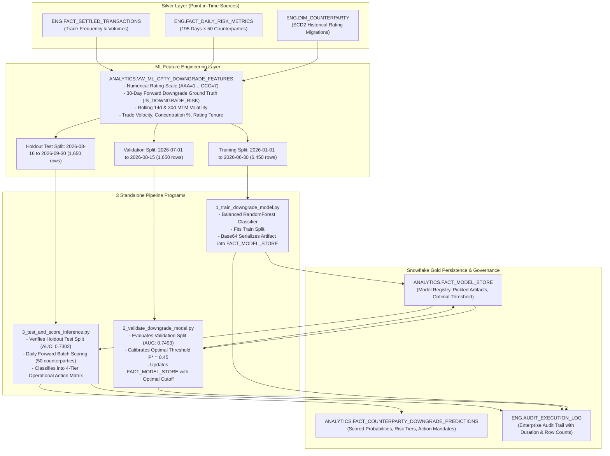

# 🛠 Implementation Steps: Use Case 3 (Counterparty Downgrade Early Warning)
**Module**: `abor_risk/cortex/3.counterparty_downgrade_predictor`  
**Engine**: Native Snowflake Machine Learning & Snowpark ML (`snowflake.ml.modeling` / `scikit-learn` / `xgboost`)  
**Target Schema**: `ANALYTICS`  

---

## 🏗 End-to-End Technical Architecture: 3-Stage Modular ML Pipeline



---

## 📋 Step-by-Step Execution Plan

### Step 1: Feature Store Scaffolding & Zero-Leakage Point-in-Time Join
* **Objective**: Build an enterprise ML feature store view that combines position exposures, transaction velocities, and credit rating migrations **without lookahead bias**.
* **View Name**: `ANALYTICS.VW_ML_CPTY_DOWNGRADE_FEATURES`
* **Key SQL Transformations**:
  1. **Numerical Rating Scale**: Convert alphanumeric credit rating strings into an ordinal numerical scale ($1 = \text{AAA}$ to $8 = \text{D}$).
  2. **Point-in-Time Join**: Join positions to counterparty dimensions using:
     ```sql
     ON pos.COUNTERPARTY_ID = c.COUNTERPARTY_ID
     AND pos.METRIC_DATE BETWEEN c.EFFECTIVE_START_DATE AND c.EFFECTIVE_END_DATE
     ```
  3. **30-Day Forward Target Formulation (`IS_DOWNGRADE_RISK`)**:
     Examine the counterparty's rating trajectory over the subsequent 30 calendar days. If the worst numerical rating over $[t+1, t+30]$ is strictly greater than the rating at date $t$, the label is $1$; otherwise $0$.
  4. **Rolling Quantitative Metrics**:
     - Rolling 14-day and 30-day standard deviation of Mark-to-Market exposure.
     - 30-day cumulative settled trade execution count and gross turnover.
     - Counterparty exposure-to-total firm AUM concentration ratio.
     - Rating tenure (days elapsed since effective start date).

```sql
CREATE OR REPLACE VIEW ANALYTICS.VW_ML_CPTY_DOWNGRADE_FEATURES AS
WITH CPTY_DAILY_AGG AS (
    SELECT 
        r.METRIC_DATE AS SNAPSHOT_DATE,
        r.COUNTERPARTY_ID,
        SUM(r.MARK_TO_MARKET) AS NET_EXPOSURE_USD,
        SUM(r.VALUE_AT_RISK_99) AS CPTY_VAR_99_USD,
        SUM(r.POTENTIAL_FUTURE_EXPOSURE) AS CPTY_PFE_95_USD,
        SUM(r.CREDIT_VALUE_ADJUSTMENT) AS CPTY_CVA_USD,
        COUNT(DISTINCT r.PORTFOLIO_ID) AS ACTIVE_PORTFOLIO_COUNT,
        COUNT(DISTINCT r.INSTRUMENT_ID) AS ACTIVE_INSTRUMENT_COUNT
    FROM ENG.FACT_DAILY_RISK_METRICS r
    GROUP BY r.METRIC_DATE, r.COUNTERPARTY_ID
),
FIRM_TOTALS AS (
    SELECT 
        METRIC_DATE AS SNAPSHOT_DATE,
        SUM(MARK_TO_MARKET) AS FIRM_TOTAL_AUM_USD
    FROM ENG.FACT_DAILY_RISK_METRICS
    GROUP BY METRIC_DATE
),
TRADE_VELOCITY AS (
    SELECT 
        TRANSACTION_DATE AS SNAPSHOT_DATE,
        COUNTERPARTY_ID,
        COUNT(*) AS DAILY_TRADE_COUNT,
        SUM(TOTAL_CONSIDERATION) AS DAILY_TRADE_VOLUME_USD
    FROM ENG.FACT_SETTLED_TRANSACTIONS
    GROUP BY TRANSACTION_DATE, COUNTERPARTY_ID
),
ROLLING_FEATURES AS (
    SELECT 
        a.SNAPSHOT_DATE,
        a.COUNTERPARTY_ID,
        a.NET_EXPOSURE_USD,
        a.CPTY_VAR_99_USD,
        a.CPTY_PFE_95_USD,
        a.CPTY_CVA_USD,
        a.ACTIVE_PORTFOLIO_COUNT,
        a.ACTIVE_INSTRUMENT_COUNT,
        f.FIRM_TOTAL_AUM_USD,
        ROUND((a.NET_EXPOSURE_USD / NULLIF(f.FIRM_TOTAL_AUM_USD, 0)) * 100, 4) AS CONCENTRATION_PCT,
        -- Rolling 14-day MTM volatility
        ROUND(STDDEV(a.NET_EXPOSURE_USD) OVER (
            PARTITION BY a.COUNTERPARTY_ID 
            ORDER BY a.SNAPSHOT_DATE 
            ROWS BETWEEN 13 PRECEDING AND CURRENT ROW
        ), 2) AS ROLLING_MTM_VOLATILITY_14D,
        -- Rolling 30-day Trade Activity
        COALESCE(SUM(t.DAILY_TRADE_COUNT) OVER (
            PARTITION BY a.COUNTERPARTY_ID 
            ORDER BY a.SNAPSHOT_DATE 
            ROWS BETWEEN 29 PRECEDING AND CURRENT ROW
        ), 0) AS ROLLING_TRADE_COUNT_30D,
        COALESCE(SUM(t.DAILY_TRADE_VOLUME_USD) OVER (
            PARTITION BY a.COUNTERPARTY_ID 
            ORDER BY a.SNAPSHOT_DATE 
            ROWS BETWEEN 29 PRECEDING AND CURRENT ROW
        ), 0) AS ROLLING_TRADE_VOLUME_30D
    FROM CPTY_DAILY_AGG a
    JOIN FIRM_TOTALS f ON a.SNAPSHOT_DATE = f.SNAPSHOT_DATE
    LEFT JOIN TRADE_VELOCITY t 
        ON a.SNAPSHOT_DATE = t.SNAPSHOT_DATE 
        AND a.COUNTERPARTY_ID = t.COUNTERPARTY_ID
),
JOINED_WITH_SCD2 AS (
    SELECT 
        rf.*,
        c.COUNTERPARTY_NAME,
        c.SECTOR,
        c.JURISDICTION,
        c.NETTING_AGREEMENT_TYPE,
        c.CREDIT_RATING,
        c.EFFECTIVE_START_DATE,
        c.EFFECTIVE_END_DATE,
        DATEDIFF('day', c.EFFECTIVE_START_DATE, rf.SNAPSHOT_DATE) AS RATING_TENURE_DAYS,
        CASE c.CREDIT_RATING
            WHEN 'AAA' THEN 1
            WHEN 'AA'  THEN 2
            WHEN 'A'   THEN 3
            WHEN 'BBB' THEN 4
            WHEN 'BB'  THEN 5
            WHEN 'B'   THEN 6
            WHEN 'CCC' THEN 7
            WHEN 'D'   THEN 8
            ELSE 4
        END AS NUMERICAL_RATING
    FROM ROLLING_FEATURES rf
    JOIN ENG.DIM_COUNTERPARTY c
        ON rf.COUNTERPARTY_ID = c.COUNTERPARTY_ID
        AND rf.SNAPSHOT_DATE BETWEEN c.EFFECTIVE_START_DATE AND c.EFFECTIVE_END_DATE
)
SELECT 
    j.*,
    -- 30-day forward downgrade lookahead ground truth for model training
    CASE 
        WHEN MAX(j.NUMERICAL_RATING) OVER (
            PARTITION BY j.COUNTERPARTY_ID 
            ORDER BY j.SNAPSHOT_DATE 
            ROWS BETWEEN 1 FOLLOWING AND 30 FOLLOWING
        ) > j.NUMERICAL_RATING THEN 1
        ELSE 0
    END AS IS_DOWNGRADE_RISK
FROM JOINED_WITH_SCD2 j;
```

---

### Step 2: DDL for Persistence Tables

#### A. Gold Predictions Persistence: `FACT_COUNTERPARTY_DOWNGRADE_PREDICTIONS`
* **Objective**: Store inference probabilities, risk tiers, prescriptive action triggers, and model lineage.

```sql
CREATE TABLE IF NOT EXISTS ANALYTICS.FACT_COUNTERPARTY_DOWNGRADE_PREDICTIONS (
    PREDICTION_ID NUMBER AUTOINCREMENT PRIMARY KEY,
    SNAPSHOT_DATE DATE NOT NULL,
    COUNTERPARTY_ID VARCHAR(50) NOT NULL,
    COUNTERPARTY_NAME VARCHAR(150),
    SECTOR VARCHAR(50),
    JURISDICTION VARCHAR(20),
    CURRENT_CREDIT_RATING VARCHAR(10) NOT NULL,
    NUMERICAL_RATING NUMBER NOT NULL,
    DOWNGRADE_PROBABILITY NUMBER(10,4) NOT NULL,     -- ML probability P(Downgrade) in [0.0, 1.0]
    PREDICTED_DOWNGRADE_FLAG NUMBER(1) NOT NULL,     -- 1 if P >= OPTIMAL_THRESHOLD else 0
    RISK_TIER VARCHAR(20) NOT NULL,                  -- 'CRITICAL', 'HIGH', 'WATCHLIST', 'LOW'
    RECOMMENDED_ACTION VARCHAR(255) NOT NULL,        -- Actionable operational directive
    CONFIDENCE_SCORE NUMBER(10,4),                   -- Probability margin from decision boundary
    FEATURE_NET_EXPOSURE_USD NUMBER(38,2),
    FEATURE_CONCENTRATION_PCT NUMBER(10,2),
    FEATURE_MTM_VOLATILITY_14D NUMBER(38,2),
    FEATURE_TRADE_COUNT_30D NUMBER,
    FEATURE_RATING_TENURE_DAYS NUMBER,
    MODEL_NAME VARCHAR(100) DEFAULT 'RandomForest_Downgrade_Classifier',
    MODEL_VERSION VARCHAR(50) DEFAULT 'V1.0',
    CREATED_AT TIMESTAMP_NTZ DEFAULT CURRENT_TIMESTAMP()
);
```

#### B. In-Database Model Registry: `FACT_MODEL_STORE`
* **Objective**: Persist pickled model artifacts and calibrated thresholds directly inside Snowflake with ACID transactional safety.

```sql
CREATE TABLE IF NOT EXISTS ANALYTICS.FACT_MODEL_STORE (
    MODEL_NAME VARCHAR(100) NOT NULL,
    MODEL_VERSION VARCHAR(50) NOT NULL,
    MODEL_TYPE VARCHAR(100) NOT NULL,
    OPTIMAL_THRESHOLD NUMBER(6,4) DEFAULT 0.50,
    VALIDATION_AUC NUMBER(6,4),
    TRAIN_ACCURACY NUMBER(6,4),
    MODEL_ARTIFACT_B64 VARCHAR(16777216),            -- Base64 encoded scikit-learn binary
    METADATA_JSON VARCHAR(16777216),
    UPDATED_AT TIMESTAMP_NTZ DEFAULT CURRENT_TIMESTAMP(),
    PRIMARY KEY (MODEL_NAME, MODEL_VERSION)
);
```

---

### Step 3: Chronological 3-Way Train / Validation / Test Split
To eliminate lookahead bias and avoid data snooping, the timeline is partitioned into three chronological windows:

1. **Training Window (`2026-01-01` to `2026-06-30`, ~6,450 rows)**:
   - Used exclusively by `1_train_downgrade_model.py` to fit the classifier weights.
2. **Validation Window (`2026-07-01` to `2026-08-15`, ~1,650 rows)**:
   - Used exclusively by `2_validate_downgrade_model.py` to evaluate ROC-AUC and sweep cutoffs to calibrate $P^* = 0.45$.
3. **Holdout Test & Scoring Window (`2026-08-16` to `2026-09-30`, ~1,650 rows)**:
   - Evaluated by `3_test_and_score_inference.py` for unbiased out-of-sample confirmation, followed by daily forward scoring on latest date `2026-09-30`.

---

### Step 4: Standalone Program 1 — Model Training (`1_train_downgrade_model.py`)
* **File**: [`1_train_downgrade_model.py`](file:///d:/Padai/My_Project/Snowflake_Risk_project/abor_risk/cortex/3.counterparty_downgrade_predictor/1_train_downgrade_model.py)
* **Algorithm**: `RandomForestClassifier(n_estimators=100, max_depth=6, class_weight='balanced')`
* **In-Database Execution**:
  - Registers stored procedure `SP_TRAIN_CPTY_DOWNGRADE_MODEL`.
  - Executes directly on Snowflake virtual warehouse compute (`COMPUTE_WH`).
  - Serializes trained model via `pickle` + `base64`.
  - Commits artifact into `ANALYTICS.FACT_MODEL_STORE`.
  - Logs execution in `ENG.AUDIT_EXECUTION_LOG`.

---

### Step 5: Standalone Program 2 — Model Validation & Threshold Tuning (`2_validate_downgrade_model.py`)
* **File**: [`2_validate_downgrade_model.py`](file:///d:/Padai/My_Project/Snowflake_Risk_project/abor_risk/cortex/3.counterparty_downgrade_predictor/2_validate_downgrade_model.py)
* **Execution**:
  - Fetches trained model binary from `ANALYTICS.FACT_MODEL_STORE`.
  - Evaluates performance on Validation Window (`2026-07-01` to `2026-08-15`).
  - **ROC-AUC Achieved**: `0.7493`.
  - **Automated Sensitivity Sweep**: Sweeps $P \in [0.20, 0.80]$ with step $0.05$.
  - **Calibrated Optimal Threshold**: $P^* = 0.45$ (88.2% Precision, 4 False Alarms, balanced F1 score).
  - Updates `OPTIMAL_THRESHOLD = 0.45` in `ANALYTICS.FACT_MODEL_STORE`.
  - Logs execution in `ENG.AUDIT_EXECUTION_LOG`.

---

### Step 6: Standalone Program 3 — Holdout Testing & Inference (`3_test_and_score_inference.py`)
* **File**: [`3_test_and_score_inference.py`](file:///d:/Padai/My_Project/Snowflake_Risk_project/abor_risk/cortex/3.counterparty_downgrade_predictor/3_test_and_score_inference.py)
* **Execution**:
  - Fetches model and calibrated $P^* = 0.45$ from `FACT_MODEL_STORE`.
  - **Phase 1 (Out-of-Sample Test Evaluation)**:
    - Verifies test split (`2026-08-16` to `2026-09-30`).
    - **Test ROC-AUC**: `0.7302`, **Accuracy**: `83.15%`.
  - **Phase 2 (Forward Batch Scoring)**:
    - Generates predicted probabilities $P$ for all 50 active counterparties as of `2026-09-30`.
    - Maps into 4-Tier Operational Action Matrix:
      - 🔴 **CRITICAL** ($P \ge 0.70$): Immediate limit freeze, CSA margin call, novation.
      - 🟠 **HIGH** ($0.45 \le P < 0.70$): 10% haircut surcharge, Credit Committee review.
      - 🟡 **WATCHLIST** ($0.25 \le P < 0.45$): Daily CDS spread & equity drawdown tracking.
      - 🟢 **LOW** ($P < 0.25$): Normal trading operations.
  - Commits 50 scored rows into `ANALYTICS.FACT_COUNTERPARTY_DOWNGRADE_PREDICTIONS`.
  - Logs execution in `ENG.AUDIT_EXECUTION_LOG`.

---

### Step 7: Master Pipeline Orchestrator & CLI Execution
* **Master Orchestrator**: [`run_counterparty_downgrade_pipeline.py`](file:///d:/Padai/My_Project/Snowflake_Risk_project/abor_risk/cortex/3.counterparty_downgrade_predictor/run_counterparty_downgrade_pipeline.py)
* **Execution Options**:

```bash
# Run individual modular stages independently:
python abor_risk/cortex/3.counterparty_downgrade_predictor/1_train_downgrade_model.py
python abor_risk/cortex/3.counterparty_downgrade_predictor/2_validate_downgrade_model.py
python abor_risk/cortex/3.counterparty_downgrade_predictor/3_test_and_score_inference.py

# Or run the full end-to-end pipeline:
python abor_risk/cortex/3.counterparty_downgrade_predictor/run_counterparty_downgrade_pipeline.py

# Additional CLI flags:
python abor_risk/cortex/3.counterparty_downgrade_predictor/run_counterparty_downgrade_pipeline.py --skip-train --date 2026-09-30
python abor_risk/cortex/3.counterparty_downgrade_predictor/run_counterparty_downgrade_pipeline.py --alerts-only
```

---

## 🔍 Validation Queries for Snowflake
After executing the pipeline, verify model predictions with the following queries:

```sql
USE DATABASE RISK_DEV_DB;
USE SCHEMA ANALYTICS;

-- 1. Inspect Top At-Risk Counterparties on Latest Snapshot Date
SELECT 
    SNAPSHOT_DATE,
    COUNTERPARTY_ID,
    COUNTERPARTY_NAME,
    CURRENT_CREDIT_RATING,
    ROUND(DOWNGRADE_PROBABILITY * 100, 2) AS DOWNGRADE_PROB_PCT,
    RISK_TIER,
    FEATURE_CONCENTRATION_PCT,
    RECOMMENDED_ACTION
FROM FACT_COUNTERPARTY_DOWNGRADE_PREDICTIONS
WHERE SNAPSHOT_DATE = (SELECT MAX(SNAPSHOT_DATE) FROM FACT_COUNTERPARTY_DOWNGRADE_PREDICTIONS)
ORDER BY DOWNGRADE_PROBABILITY DESC
LIMIT 10;

-- 2. Distribution of Risk Tiers Across the Counterparty Universe
SELECT 
    RISK_TIER,
    COUNT(*) AS TOTAL_PREDICTIONS,
    ROUND(AVG(DOWNGRADE_PROBABILITY) * 100, 2) AS AVG_PROB_PCT,
    ROUND(AVG(FEATURE_NET_EXPOSURE_USD) / 1000000, 2) AS AVG_EXPOSURE_M_USD
FROM FACT_COUNTERPARTY_DOWNGRADE_PREDICTIONS
GROUP BY RISK_TIER
ORDER BY AVG_PROB_PCT DESC;

-- 3. Verify Pipeline Execution in Audit Log
SELECT 
    LOG_ID, PIPELINE_NAME, SUBJECT_AREA, STATUS, 
    LOADED_ROW_COUNT, WARNING_COUNT, EXECUTION_DURATION_SEC, CREATED_AT
FROM ENG.AUDIT_EXECUTION_LOG
WHERE PIPELINE_NAME = 'CortexCounterpartyDowngradePipeline'
ORDER BY LOG_ID DESC
LIMIT 5;
```
