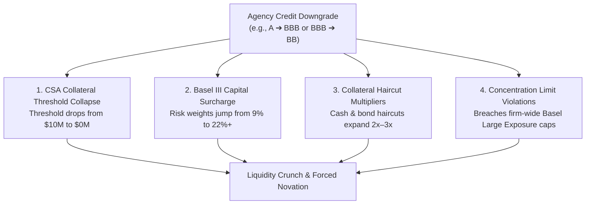

# 📉 Use Case 3: Predictive Counterparty Credit Rating Downgrade Early Warning
**Module**: `abor_risk/cortex/3.counterparty_downgrade_predictor`  
**Engine**: Native Snowflake Machine Learning & Snowpark ML (`snowflake.ml.modeling` / `scikit-learn` / `xgboost`)  
**Target Persona**: Chief Risk Officer (CRO), Head of Counterparty Credit Risk, Collateral & Treasury Desk, Investment Committee  

---

## 💡 The Problem in Layman's Terms: Autopsy Reports vs. Vital Sign Monitors

Imagine a patient admitted to an intensive care unit:
* **The Traditional Approach (Autopsy / Rating Agency Press Release)**: The doctor waits until the patient goes into cardiac arrest, and the county coroner files an official certificate stating: *"The patient has collapsed."* It tells you the exact truth, but by the time the paper is stamped, it is impossible to intervene.
* **The Predictive Early Warning (Vital Sign Telemetry & Machine Learning)**: Monitors blood pressure, pulse variation, and oxygen saturation second-by-second. Thirty minutes before cardiac arrest, the monitor alarms: *"Warning: Patient vitals deteriorating—intervene immediately!"* The medical team administers medication, stabilizes blood flow, and prevents the collapse altogether.

In global banking and asset management, **90% of counterparty risk systems still wait for the coroner's certificate**. 
Credit rating agencies like **Moody's, Standard & Poor's (S&P), and Fitch** are notoriously **lagging indicators**:
* In the 2008 Financial Crisis, Lehman Brothers was rated **Investment Grade (A2 / A)** just days before filing for bankruptcy.
* In March 2023, Credit Suisse suffered catastrophic deposit flight and credit default swap (CDS) blowouts weeks before rating agencies formally completed their downgrade cycles.

When a rating agency publishes a downgrade, **every bank and hedge fund on Wall Street receives the notification at the exact same second**. A chaotic stampede follows: every institution simultaneously issues margin calls, refuses to roll over repo financing, and pulls collateral. Counterparties with delayed reactions end up holding illiquid, uncollateralized claims in bankruptcy court.

**Use Case 3 turns Snowflake into a predictive vital-signs monitor.** By synthesizing trade velocity, mark-to-market volatility, exposure concentration, and rating tenure into an in-database Machine Learning model, the system predicts whether a counterparty is at risk of a rating downgrade over the **next 30 business days**—allowing the firm to act weeks before the public announcement.

---

## 🌪️ The Catastrophic Financial Chain Reaction of a Rating Downgrade

A counterparty credit downgrade is not merely a cosmetic badge; under institutional derivatives and banking regulations, it triggers an immediate, multi-million dollar chain reaction:



### 1. Collateral Threshold Collapse (Credit Support Annex - CSA)
* Under standard **ISDA Master Agreements**, an Investment Grade broker might have a **\$10 Million unsecured threshold** (neither party posts collateral if net exposure is under \$10M).
* If that broker is downgraded below Investment Grade (a "Fallen Angel" event), contractual trigger clauses drop the threshold to **\$0 immediately**. The broker must post millions of dollars in cash overnight, often sparking a liquidity crisis.

### 2. Regulatory Capital Multipliers (Basel III Standardized Approach)
* Basel III banking frameworks mandate that capital reserves set aside for unhedged exposures be multiplied by the counterparty's risk weight:
  $$\text{AAA} \to 4\% \quad\Big|\quad \text{AA} \to 6\% \quad\Big|\quad \text{A} \to 9\% \quad\Big|\quad \text{BBB} \to 13\% \quad\Big|\quad \text{BB} \to 22\% \quad\Big|\quad \text{B} \to 35\%$$
* When a counterparty slips from **A (9%)** to **BB (22%)**, the bank must **more than double** the regulatory capital locked away for that single relationship.

### 3. Haircut Surcharges & Liquidity Freezes
* Prime brokers automatically discount the value of collateral pledged by downgraded entities. If a hedge fund counterparty's rating slips, their Treasury bills and corporate bonds are discounted at punitive haircuts (e.g., 15% instead of 2%), requiring more capital to support the same portfolio size.

---

## 🧭 Key Financial & Data Modeling Concepts Explained Simply

### 1. Counterparty Credit Risk (CCR) vs. Market Risk
* **Market Risk (VaR)** asks: *"If the market drops 5% tomorrow, how much do my assets lose in value?"*
* **Counterparty Credit Risk (CCR)** asks: *"If the broker who sold me this profitable derivative goes bankrupt, will I ever collect my \$50 Million in winnings?"*

### 2. Point-in-Time Truth & SCD Type 2 Safety (Zero Lookahead Leakage)
* Our platform tracks counterparty histories via **Slowly Changing Dimension Type 2 (SCD2)** in `ENG.DIM_COUNTERPARTY`.
* Each record contains `EFFECTIVE_START_DATE` and `EFFECTIVE_END_DATE`.
* **The Golden Rule**: When evaluating counterparty risk on `2026-03-15`, the feature engine must strictly join on the rating that was active on `2026-03-15`. It must **never** peek at a rating that took effect on `2026-06-01`. Any temporal leak invalidates backtesting and inflates model performance with false signals.

### 3. The Numerical Credit Rating Ladder
To train machine learning algorithms, discrete alphanumeric ratings are mapped onto an ordinal numerical scale:

| Rating Band | Numerical Score | Category | Basel III Standard Risk Weight |
| :---: | :---: | :--- | :---: |
| **AAA** | 1 | Prime / Maximum Safety | 4% |
| **AA** | 2 | High Quality Grade | 6% |
| **A** | 3 | Upper Medium Investment Grade | 9% |
| **BBB** | 4 | Lower Medium Investment Grade | 13% |
| **BB** | 5 | Speculative / "Junk" / Non-Investment Grade | 22% |
| **B** | 6 | Highly Speculative | 35% |
| **CCC** | 7 | Substantial Credit Risk / Distressed | 75% |
| **D** | 8 | In Default / Bankruptcy | 100% |

### 4. Mathematical Target Formulation: 30-Day Forward Downgrade
Let $R(c, t)$ denote the numerical credit rating of counterparty $c$ at snapshot date $t$.  
Over a forward monitoring horizon of $H = 30$ business days:

$$y(c, t) = \begin{cases} 1 & \text{if } \exists \, \tau \in [t+1, t+H] \text{ such that } R(c, \tau) > R(c, t) \quad \text{(Rating Deteriorated)} \\ 0 & \text{otherwise} \end{cases}$$

---

## 🧠 Predictive Feature Indicators: What Signals Does the ML Model Learn?

The ML classifier learns from 5 core families of behavioral and quantitative signals:

```text
┌────────────────────────────────────────────────────────────────────────────────────────┐
│                        PREDICTIVE FEATURE STORE INDICATORS                             │
└────────────────────────────────────────────────────────────────────────────────────────┘

  [ 1. EXPOSURE VOLATILITY ] ───► Rolling 14-Day & 30-Day MTM Standard Deviation
                                  "Erratic swings in net marked-to-market balances often
                                   signal unhedged portfolio turbulence or margin distress."

  [ 2. CONCENTRATION RATIO ] ───► (Counterparty Net Exposure / Firm Total AUM) × 100
                                  "Measures firm-wide vulnerability under Basel Large
                                   Exposure regulations (thresholds at 5% and 10%)."

  [ 3. RATING TENURE ]       ───► Days Elapsed Since Last Rating Migration Event
                                  "Counterparties that have held a deteriorating BBB or BB
                                   rating for > 90 days exhibit escalating downgrade hazard."

  [ 4. TRADING VELOCITY ]    ───► 30-Day Settled Transaction Count & Turnover Velocity
                                  "Sudden spikes in trade frequency or urgent ticket cancellations
                                   indicate desperate rebalancing or counterparty liquidity runs."

  [ 5. CREDIT TAIL SPREAD ]  ───► Potential Future Exposure (95% PFE) vs MTM Ratio
                                  "A rising PFE/MTM ratio indicates expanding uncollateralized
                                   tail risk if market conditions gap wider."
```

---

## 🎯 What Does This ML Model Do?

Using Snowpark ML and Snowflake virtual warehouse compute:

1. **Chronological Splitting (Never Random Shuffling)**:
   - **Training Set**: January 1, 2026 to June 30, 2026 (Months 1–6, ~125 business dates).
   - **Out-of-Sample Test & Inference Set**: July 1, 2026 to September 30, 2026 (Months 7–9, ~65 business dates).
   - Preserves causal arrow-of-time in financial markets.
2. **Supervised Classification Training**:
   - Trains an ensemble classifier (`RandomForestClassifier` / `GradientBoostingClassifier`).
   - Learns non-linear feature interactions without manual heuristic thresholds.
3. **Probability Scoring & Risk Tier Classification**:
   - Computes continuous downgrade probability $P(\text{Downgrade}) \in [0.0, 1.0]$.
   - Segments counterparties into 4 governance tiers:

| Downgrade Risk Tier | Probability Range | Automated Operational Action |
| :---: | :---: | :--- |
| 🔴 **CRITICAL** | $P \ge 70\%$ | Immediate trading freeze, demand 100% cash variation margin, initiate trade novations. |
| 🟠 **HIGH** | $40\% \le P < 70\%$ | Reduce uncollateralized credit limits by 50%, impose 10% collateral haircut surcharge. |
| 🟡 **WATCHLIST** | $20\% \le P < 40\%$ | Escalate to Daily Risk Desk review, restrict OTC derivatives tenors to $< 30$ days. |
| 🟢 **LOW** | $P < 20\%$ | Standard operational monitoring within normal approved credit limits. |

4. **Persistence in Snowflake Gold Layer**:
   - Results are committed to `ANALYTICS.FACT_COUNTERPARTY_DOWNGRADE_PREDICTIONS` alongside model feature importances, ROC-AUC metrics, and audit timestamps.

---

## 🏢 Real-World Institutional Value

| Stakeholder | Before Predictive ML (Reactive) | With Use Case 3 (Proactive) |
| :--- | :--- | :--- |
| **Chief Risk Officer (CRO)** | Learns of rating downgrades from Bloomberg terminals; scrambles to calculate firm-wide exposure after the fact. | Receives a 30-day early warning radar; reviews weekly probabilities at the Executive Risk Committee. |
| **Credit Risk Desk** | Frozen into contracts with deteriorating brokers; forced to accept whatever collateral is left. | Preemptively dials down credit lines and renegotiates bilateral CSA thresholds 3 weeks in advance. |
| **Treasury & Collateral Desk** | Trapped cash and securities inside insolvent prime brokers during sudden failures. | Reroutes overnight repo funding and sweeps excess cash collateral to AAA-rated clearing banks. |
| **Regulators (Basel / SEC / CCAR)** | Issues supervisory deficiency notices for passive credit risk monitoring. | Commends the institution for deploying automated, point-in-time machine learning early warning systems. |

---

## 📊 Visualizing the Early Warning Timeline

```text
   Counterparty Credit Health
       ▲
  AAA  │   (Normal Stable Operation)
       │   ══════════════════════╗
   AA  │                         ╚═══════════════╗
       │                                         ║  [!] ML EARLY WARNING TRIGGERED
    A  │                                         ║      Probability = 84.2% (CRITICAL)
       │                                         ╚═══════════════╗
  BBB  │                                                         ║   Rating Agency
       │                                                         ║   Downgrade Announced
   BB  │                                                         ╚════════════════════► Time
       └───────────────────────────────────────────────────────────────▲─────────────────►
                                         │◄─── 30-Day Window ─────────►│
                                       T - 30 Days                   T = 0
                                 (Risk desk pulls lines &         (Public Stampede;
                                  secures collateral here)         Too late to act)
```

---

## 🔗 Next Steps
With the problem formulation and quantitative theory fully articulated, see [IMPLEMENTATION_STEPS.md](file:///d:/Padai/My_Project/Snowflake_Risk_project/abor_risk/cortex/3.counterparty_downgrade_predictor/IMPLEMENTATION_STEPS.md) for the end-to-end Snowflake DDL, Snowpark ML feature engineering, model training, and automated verification procedures.
