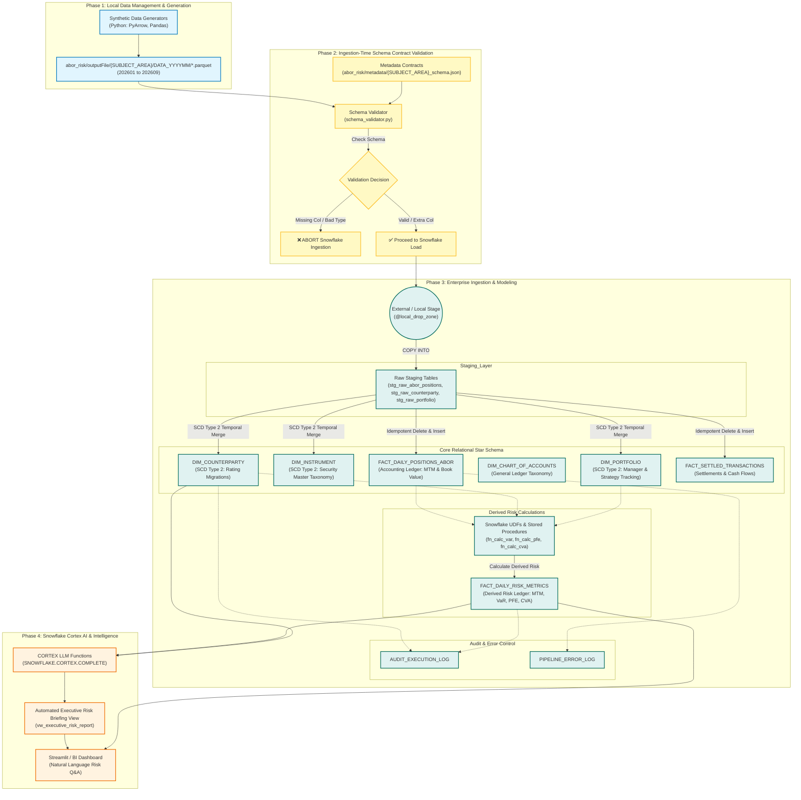

# Institutional ABOR & Quantitative Risk Intelligence Platform (ABORT-RISK-360)

## 📌 Executive Synopsis & Business Objective

In institutional asset management, prime brokerage, and capital markets (e.g., TIAA, Jefferies), financial ledgers are traditionally bifurcated into two separate domains:

1. **Accounting Book of Record (ABOR)**: Manages official settled positions, historical cost bases, multi-currency cash flows, tax lots, and general ledger P&L.
2. **Quantitative Risk Engine**: Calculates forward-looking risk exposures, such as 99% Value-at-Risk (VaR), Potential Future Exposure (PFE), and Credit Value Adjustment (CVA).

The **ABORT-RISK-360** platform bridges this divide inside **Snowflake** using **Python Snowpark**, dynamic SQL User-Defined Functions (UDFs), idempotent staging pipelines, ingestion-time schema contract validation, and **Snowflake Cortex AI**.

---

## 🏗 End-to-End System Architecture



---

## 📁 Data Storage & Folder Layout (`202601` to `202609`)

Datasets are generated locally in **Parquet** format, partitioned by subject area and target month (`YYYYMM`):

```text
abor_risk/outputFile/
├── COUNTERPARTY/
│   ├── DATA_202601/dim_counterparty_202601.parquet
│   ├── ...
│   └── DATA_202609/dim_counterparty_202609.parquet
├── INSTRUMENT/
│   ├── DATA_202601/dim_instrument_202601.parquet
│   ├── ...
│   └── DATA_202609/dim_instrument_202609.parquet
└── PORTFOLIO/
    ├── DATA_202601/dim_portfolio_202601.parquet
    ├── ...
    └── DATA_202609/dim_portfolio_202609.parquet
```

---

## 📊 Database Schema Specifications

### 1. Dimension Tables

#### `DIM_COUNTERPARTY` (SCD Type 2 - Temporal Credit Tracking)
Tracks institutional counterparties, credit rating migrations, sector, and jurisdiction over time.

| Column Name | Type | Key | Description |
| :--- | :--- | :--- | :--- |
| `COUNTERPARTY_KEY` | `NUMBER` | Primary (Surrogate) | Auto-incrementing surrogate key |
| `COUNTERPARTY_ID` | `VARCHAR(50)` | Business Key | Natural entity identifier (e.g., `CPTY_001`) |
| `COUNTERPARTY_NAME` | `VARCHAR(255)` | | Legal entity name |
| `LEI_CODE` | `VARCHAR(50)` | | 20-character Legal Entity Identifier |
| `SECTOR` | `VARCHAR(100)` | | Entity sector (`Pension Fund`, `Hedge Fund`, `Sovereign`) |
| `CREDIT_RATING` | `VARCHAR(10)` | | Active credit rating (`AAA`, `AA`, `A`, `BBB`, `BB`, `B`, `CCC`) |
| `JURISDICTION` | `VARCHAR(50)` | | Country/region code (`US`, `UK`, `EU`, `KY`, `JP`) |
| `NETTING_AGREEMENT_TYPE` | `VARCHAR(50)` | | Legal collateral agreement (`ISDA_CSA`, `GMRA`, `EMA`, `NONE`) |
| `EFFECTIVE_START_DATE`| `DATE` | | Effective start date of credit version |
| `EFFECTIVE_END_DATE`  | `DATE` | | Effective end date of credit version (`9999-12-31` for active) |
| `IS_ACTIVE` | `BOOLEAN` | | Active version flag (`TRUE`/`FALSE`) |

#### `DIM_INSTRUMENT` (SCD Type 2 - Multi-Asset Security Master)
Master taxonomy for financial instruments across asset classes with dynamic sub-asset reclassifications.

| Column Name | Type | Description |
| :--- | :--- | :--- |
| `INSTRUMENT_ID` | `VARCHAR(50)` | Security ticker or ID (e.g., `INST_101`) |
| `INSTRUMENT_NAME` | `VARCHAR(255)` | Full security title |
| `ASSET_CLASS` | `VARCHAR(100)` | Asset class (`Fixed Income`, `Derivatives`, `Foreign Exchange`, `Equities`) |
| `SUB_ASSET_CLASS` | `VARCHAR(100)` | Granular sub-asset category |
| `CURRENCY` | `VARCHAR(10)` | ISO currency code (`USD`, `EUR`, `GBP`) |
| `MATURITY_DATE` | `DATE` | Contractual maturity date (Nullable for equities) |
| `EFFECTIVE_START_DATE`| `DATE` | Effective start date |
| `EFFECTIVE_END_DATE`  | `DATE` | Effective end date (`9999-12-31` for active) |
| `IS_ACTIVE` | `BOOLEAN` | Active version flag |

#### `DIM_PORTFOLIO` (SCD Type 2 - Fund & Portfolio Master)
Master catalog tracking investment portfolios, funds, base accounting currencies, portfolio manager reassignments, and investment strategy updates over time.

| Column Name | Type | Key | Description |
| :--- | :--- | :--- | :--- |
| `PORTFOLIO_KEY` | `NUMBER` | Primary (Surrogate) | Auto-incrementing surrogate key |
| `PORTFOLIO_ID` | `VARCHAR(50)` | Business Key | Natural portfolio identifier (e.g., `PORT_001`) |
| `PORTFOLIO_NAME` | `VARCHAR(255)` | | Official fund title |
| `BASE_CURRENCY` | `VARCHAR(10)` | | Base accounting currency (`USD`, `EUR`, `GBP`) |
| `PORTFOLIO_MANAGER` | `VARCHAR(100)` | | Active Portfolio Manager / Lead |
| `INVESTMENT_STRATEGY` | `VARCHAR(100)` | | Investment strategy taxonomy |
| `INCEPTION_DATE` | `DATE` | | Portfolio inception date |
| `EFFECTIVE_START_DATE`| `DATE` | | Effective start date |
| `EFFECTIVE_END_DATE`  | `DATE` | | Effective end date (`9999-12-31` for active) |
| `IS_ACTIVE` | `BOOLEAN` | | Active version flag (`TRUE`/`FALSE`) |

---

### 2. Fact Tables

#### `FACT_DAILY_POSITIONS_ABOR` (Accounting Book of Record)
Official end-of-day holdings per portfolio, fund, and counterparty.

| Column Name | Type | Description |
| :--- | :--- | :--- |
| `POSITION_DATE` | `DATE` | Business position snapshot date |
| `PORTFOLIO_ID` | `VARCHAR(50)` | Internal fund/portfolio ID |
| `COUNTERPARTY_ID` | `VARCHAR(50)` | Counterparty entity link |
| `INSTRUMENT_ID` | `VARCHAR(50)` | Instrument link |
| `SETTLED_QUANTITY` | `NUMBER(38,4)` | Officially settled position units |
| `BOOK_VALUE` | `NUMBER(38,2)` | Original cost basis in USD |
| `MARKET_VALUE` | `NUMBER(38,2)` | End-of-day Mark-to-Market value in USD |
| `UNREALIZED_PNL` | `NUMBER(38,2)` | Market Value minus Book Value |
| `INGESTED_AT` | `TIMESTAMP_NTZ` | Load timestamp |

#### `FACT_DAILY_RISK_METRICS` (Derived Quantitative Risk Layer)
Calculated daily quantitative risk ledger derived from ABOR positions & active counterparty credit ratings.

| Column Name | Type | Description |
| :--- | :--- | :--- |
| `METRIC_DATE` | `DATE` | Risk calculation date |
| `PORTFOLIO_ID` | `VARCHAR(50)` | Portfolio entity link |
| `COUNTERPARTY_ID` | `VARCHAR(50)` | Counterparty entity link |
| `INSTRUMENT_ID` | `VARCHAR(50)` | Instrument link |
| `MARK_TO_MARKET` | `NUMBER(38,2)` | Mark-to-Market valuation |
| `VALUE_AT_RISK_99` | `NUMBER(38,2)` | **99% Value-at-Risk (1-day horizon)** |
| `POTENTIAL_FUTURE_EXPOSURE` | `NUMBER(38,2)` | **Potential Future Exposure (PFE at 95% confidence)** |
| `CREDIT_VALUE_ADJUSTMENT` | `NUMBER(38,2)` | **Credit Value Adjustment (CVA pricing impact)** |
| `CALCULATED_AT` | `TIMESTAMP_NTZ` | Calculation timestamp |

---

## 🛡 Ingestion-Time Schema Contract Validation Policy

Validation executes **at Snowflake loading time** using `schema_validator.py` matching Parquet files against `abor_risk/metadata/{SUBJECT_AREA}_schema.json`:

| Scenario | Behavior | Action Taken |
| :--- | :--- | :--- |
| **Missing Required Column** | ❌ Violates Data Contract | **ABORTS execution immediately** with an explicit error detailing missing fields. |
| **Data Type Mismatch** | ❌ Violates Data Contract | **ABORTS execution immediately** showing expected vs found data types. |
| **Extra / Surplus Column** | ✅ Additive Schema Evolution | **ALLOWED** — logs an `[INFO]` message and proceeds with Snowflake load. |

---

## 🧮 Quantitative Risk Logic & Snowflake Objects

### 1. Custom Risk Weight UDF (`FN_GET_CREDIT_RISK_WEIGHT`)

```sql
CREATE OR REPLACE FUNCTION FN_GET_CREDIT_RISK_WEIGHT(rating VARCHAR)
RETURNS FLOAT
LANGUAGE SQL
AS
$$
  CASE rating
    WHEN 'AAA' THEN 0.04
    WHEN 'AA'  THEN 0.06
    WHEN 'A'   THEN 0.09
    WHEN 'BBB' THEN 0.13
    WHEN 'BB'  THEN 0.22
    WHEN 'B'   THEN 0.28
    ELSE 0.35
  END
$$;
```

### 2. Derived Risk Transformation Procedure

```sql
CREATE OR REPLACE PROCEDURE SP_CALCULATE_DAILY_RISK_METRICS(batch_date_str VARCHAR)
RETURNS VARCHAR
LANGUAGE SQL
AS
$$
BEGIN
    -- 1. Partition Cleanup (Idempotency)
    DELETE FROM FACT_DAILY_RISK_METRICS 
    WHERE METRIC_DATE = CAST(:batch_date_str AS DATE);

    -- 2. Risk Calculation Insertion
    INSERT INTO FACT_DAILY_RISK_METRICS (
        METRIC_DATE,
        PORTFOLIO_ID,
        COUNTERPARTY_ID,
        INSTRUMENT_ID,
        MARK_TO_MARKET,
        VALUE_AT_RISK_99,
        POTENTIAL_FUTURE_EXPOSURE,
        CREDIT_VALUE_ADJUSTMENT,
        CALCULATED_AT
    )
    SELECT
        p.POSITION_DATE AS METRIC_DATE,
        p.PORTFOLIO_ID,
        p.COUNTERPARTY_ID,
        p.INSTRUMENT_ID,
        p.MARKET_VALUE AS MARK_TO_MARKET,
        -- 99% VaR Calculation
        ROUND(ABS(p.MARKET_VALUE * FN_GET_CREDIT_RISK_WEIGHT(c.CREDIT_RATING) * 1.1), 2) AS VALUE_AT_RISK_99,
        -- PFE (1.65 multiplier for 95% future peak exposure)
        ROUND(ABS(p.MARKET_VALUE * FN_GET_CREDIT_RISK_WEIGHT(c.CREDIT_RATING) * 1.1) * 1.65, 2) AS POTENTIAL_FUTURE_EXPOSURE,
        -- CVA (Counterparty default risk pricing adjustment)
        ROUND(ABS(p.MARKET_VALUE * FN_GET_CREDIT_RISK_WEIGHT(c.CREDIT_RATING) * 1.65) * 0.015, 2) AS CREDIT_VALUE_ADJUSTMENT,
        CURRENT_TIMESTAMP()
    FROM FACT_DAILY_POSITIONS_ABOR p
    JOIN DIM_COUNTERPARTY c 
      ON p.COUNTERPARTY_ID = c.COUNTERPARTY_ID 
     AND c.IS_ACTIVE = TRUE
    WHERE p.POSITION_DATE = CAST(:batch_date_str AS DATE);

    RETURN 'SUCCESS: Daily Risk Metrics computed successfully.';
EXCEPTION
    WHEN OTHER THEN
        INSERT INTO PIPELINE_ERROR_LOG (PIPELINE_NAME, ERROR_MESSAGE, FAILED_AT)
        VALUES ('SP_CALCULATE_DAILY_RISK_METRICS', SQLERRM, CURRENT_TIMESTAMP());
        RAISE;
END;
$$;
```

---

## 🤖 Snowflake Cortex AI Integration Layer

### Automated Executive Risk Briefing SQL View (`VW_EXECUTIVE_RISK_REPORT`)

```sql
CREATE OR REPLACE VIEW VW_EXECUTIVE_RISK_REPORT AS
SELECT 
    r.METRIC_DATE,
    SNOWFLAKE.CORTEX.COMPLETE(
        'llama3.1-70b',
        CONCAT(
            'You are an executive Chief Risk Officer analyst. Provide a concise, high-level summary of portfolio exposure for business date ', r.METRIC_DATE, '. ',
            'Total Mark-to-Market is $', SUM(r.MARK_TO_MARKET), ', ',
            'Total 99% Value-at-Risk (VaR) is $', SUM(r.VALUE_AT_RISK_99), ', ',
            'Total Potential Future Exposure (PFE) is $', SUM(r.POTENTIAL_FUTURE_EXPOSURE), ', ',
            'and Total Credit Value Adjustment (CVA) is $', SUM(r.CREDIT_VALUE_ADJUSTMENT), '. ',
            'Highlight key counterparty credit risks, portfolio manager movements, and regulatory implications.'
        )
    ) AS EXECUTIVE_RISK_SUMMARY
FROM FACT_DAILY_RISK_METRICS r
GROUP BY r.METRIC_DATE;
```

---

## 🛡 Production Engineering & Governance Checklist

- [x] **Local Synthetic Data Generators**: Python scripts generating Parquet datasets across 9 months (`202601` to `202609`).
- [x] **Subject Area Dimensions**: `DIM_COUNTERPARTY` (SCD2), `DIM_INSTRUMENT` (SCD2), and `DIM_PORTFOLIO` (SCD2).
- [x] **Ingestion-Time Data Contracts**: `schema_validator.py` checking Parquet schemas against `{SUBJECT_AREA}_schema.json` prior to loading.
- [x] **Audit Lineage**: Every batch run logged in `AUDIT_EXECUTION_LOG` using `METADATA$FILENAME`.
- [x] **Partition Idempotency**: Pre-insertion partition `DELETE` commands based on business `POSITION_DATE` / `METRIC_DATE`.
- [x] **Strict Error Policy**: Execution settings `ON_ERROR = 'ABORT_STATEMENT'` wrapped in Stored Procedure `TRY...CATCH` blocks.
- [x] **Cortex Generative AI**: Instant executive commentary via `SNOWFLAKE.CORTEX.COMPLETE`.
