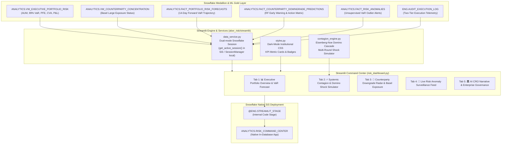

# 🛠️ Implementation Steps: Streamlit in Snowflake (SiS) Risk Command Center
**Module**: `abor_risk/streamlit`  
**Application**: `ANALYTICS.RISK_COMMAND_CENTER`  
**Engine**: Streamlit in Snowflake (SiS) + Snowpark Python + Local Virtualenv  
**Status**: ✅ LIVE & DEPLOYED IN SNOWFLAKE  

---

## 📌 Executive Architecture & Component Flow

The **Institutional Risk Command Center** is a multi-tab executive application that unifies the entire Medallion Data Platform (`RAW` $\to$ `ENG` $\to$ `ANALYTICS`), connecting quantitative risk engines, machine learning early warning systems, and systemic contagion stress tests into a single command center.



---

## 📋 Granular Step-by-Step Implementation Process

### Step 1: Environment & Dependency Configuration
1. **Add Visualization Stack to `.venv`**:
   Install Streamlit and Plotly to enable interactive charts and local browser execution:
   ```bash
   pip install streamlit plotly altair
   ```
2. **Dual-Mode Session Resolver**:
   Inside `data_service.py`, implement graceful connection discovery:
   - When running natively inside Snowflake Web UI, use `snowflake.snowpark.context.get_active_session()`.
   - When running locally from terminal, instantiate `SnowflakeSessionManager` reading `.env` and `config/dev.yaml`.

---

### Step 2: High-Performance Data Access Layer (`data_service.py`)
1. Implement cached queries using `@st.cache_data(ttl=300)` to optimize warehouse compute usage:
   - `get_available_snapshot_dates()`: Queries distinct reporting dates.
   - `get_executive_portfolio_metrics(date, portfolio_id)`: Fetches AUM, Book Value, 99% VaR, PFE, and CVA.
   - `get_var_forecasts(portfolio_id)`: Fetches 14-day forward forecast curves with 95% confidence intervals.
   - `get_counterparty_concentration(date, sector)`: Retrieves Basel concentration statuses.
   - `get_downgrade_predictions(date)`: Pulls ML credit migration probabilities and 4-tier action directives.
   - `get_risk_anomalies(portfolio_id)`: Loads unsupervised Bayesian anomaly evaluations.
   - `get_audit_logs(limit)`: Retrieves two-tier pipeline execution telemetry.

---

### Step 3: Eisenberg-Noe / Glasserman Domino Cascade Engine (`contagion_engine.py`)
1. **Mathematical Formulation**:
   - Each counterparty $i$ maintains an estimated Tier-1 capital buffer:
     $$\text{Capital}_i = \max\left(\$50\text{M}, \text{NetExposure}_i \times 1.5 \times \text{BufferRatio}_i\right)$$
     where $\text{BufferRatio} \in \{0.25 (\text{AAA}), 0.20 (\text{AA}), 0.16 (\text{A}), 0.12 (\text{BBB}), 0.08 (\text{BB}), 0.05 (\text{B})\}$.
2. **Multi-Round Cascade Algorithm**:
   - **Round 0 (Trigger Event)**: Designated entity $C_0$ defaults. Firm suffers direct credit loss:
     $$\text{Loss}_{\text{Direct}} = \text{Exposure}_{C_0} \times \text{LGD}$$
   - **Round 1 (Direct Contagion)**: Network spillover shocks surviving counterparties:
     $$\text{Shock}_j = \text{Loss}_{\text{Round } 0} \times 0.08 \times \rho_{\text{net}} + \text{Exposure}_j \times \text{Haircut}_{\text{FireSale}} \times 0.15$$
   - **Round $k$ (Domino Propagation)**: Entities whose cumulative losses exceed their capital buffer are marked insolvent, transmitting secondary shocks until an equilibrium state (zero new defaults) is attained.
   - **Systemic Contagion Index**:
     $$\text{Contagion Index} = \left(\frac{\text{Total Insolvent Counterparties}}{\text{Total Counterparty Universe}}\right) \times 100\%$$

---

### Step 4: Executive User Interface & Multi-Tab Design (`risk_dashboard.py`)
1. **Header & Global Navigation**:
   - Responsive sidebar with **Snapshot Date** picker, **Portfolio** selector (`ALL` vs `PORT_001`–`PORT_020`), and **Sector** filter.
   - Live session connectivity chip confirming active Snowflake warehouse and database.
2. **Tab 1: 📊 Executive Portfolio Overview & VaR Forecast**:
   - 5 Top KPI metric cards: Total Firm AUM, 99% VaR, 95% PFE, CVA Reserves, and Unrealized PnL.
   - Plotly bar charts of Capital vs 99% VaR allocation by portfolio.
   - Asset class and tenor donut breakdown.
   - 14-Day forward VaR trajectory forecast curve with shaded 95% confidence intervals from `ANALYTICS.FACT_PORTFOLIO_RISK_FORECASTS`.
3. **Tab 2: ⚡ Systemic Contagion & Domino Shock Simulator**:
   - Interactive stress test parameter sliders for Loss Given Default (10%–100%) and Fire-Sale Haircut (0%–50%).
   - Waterfall loss progression chart (Direct Firm Loss vs Secondary Domino Network Losses).
   - Post-shock counterparty survival vs insolvency matrix.
4. **Tab 3: 🎯 Counterparty Downgrade Radar & Basel Exposure**:
   - Basel Large Exposure horizontal bar chart with 10% regulatory limit reference line and 5% elevated watchline.
   - Machine Learning downgrade scatter plot ($P(\text{Downgrade})$ vs Net Exposure, sized by 14-day MTM volatility).
   - 4-Tier Operational Action Matrix table (`CRITICAL`, `HIGH`, `WATCHLIST`, `LOW`) with prescriptive mitigation instructions.
   - SCD Type 2 historical credit rating migration audit trail.
5. **Tab 4: 🚨 Live Risk Anomaly Surveillance**:
   - Time-series scatter plot of actual 99% VaR vs statistical operating bands.
   - Real-time surveillance ledger classifying statistical spikes and drop outliers.
6. **Tab 5: 🏛️ AI Narrative & Enterprise Governance**:
   - Chief Risk Officer (CRO) executive risk briefing synthesis.
   - In-database Snowflake Model Registry metadata (`ANALYTICS.FACT_MODEL_STORE`).
   - Pipeline execution telemetry ledger (`ENG.AUDIT_EXECUTION_LOG`).

---

### Step 5: Automated Testing & Validation (`tests/unit/test_streamlit_components.py`)
1. Test suite validates:
   - Capital buffer tier ordering ($\text{AAA} > \text{BBB} > \text{CCC}$).
   - Multi-round cascade simulation termination and loss calculations.
   - Empty input handling and error recovery.
   - HTML generation of KPI metric cards.
2. **Execution**:
   ```bash
   pytest tests/unit/test_streamlit_components.py
   # Result: 5 passed in 0.14s
   ```

---

### Step 6: Native Snowflake SiS Deployment (`deploy_sis.py` / `deploy_sis.sql`)
1. Create internal stage:
   ```sql
   CREATE STAGE IF NOT EXISTS ENG.STREAMLIT_STAGE DIRECTORY = (ENABLE = TRUE);
   ```
2. Upload dashboard Python modules (`risk_dashboard.py`, `styles.py`, `data_service.py`, `contagion_engine.py`) to `@ENG.STREAMLIT_STAGE`.
3. Create the Snowflake Streamlit object:
   ```sql
   CREATE OR REPLACE STREAMLIT ANALYTICS.RISK_COMMAND_CENTER
   ROOT_LOCATION = '@ENG.STREAMLIT_STAGE'
   MAIN_FILE = 'risk_dashboard.py'
   QUERY_WAREHOUSE = 'COMPUTE_WH'
   COMMENT = 'Institutional ABOR & Quantitative Risk Command Center Dashboard';
   ```
4. Verify deployment:
   ```bash
   python abor_risk/streamlit/deploy_sis.py
   ```

---

## 🎯 Verification & Launch Cheat Sheet

### Option A: Launch Locally
```bash
streamlit run abor_risk/streamlit/risk_dashboard.py
```

### Option B: Access Inside Snowflake
1. Log in to your Snowflake Web UI (`yjanmbj-em54153`).
2. Navigate to **Projects** $\to$ **Streamlit**.
3. Select **`RISK_COMMAND_CENTER`** in schema **`ANALYTICS`**.
4. The dashboard will load directly within Snowflake's role-based security context!
